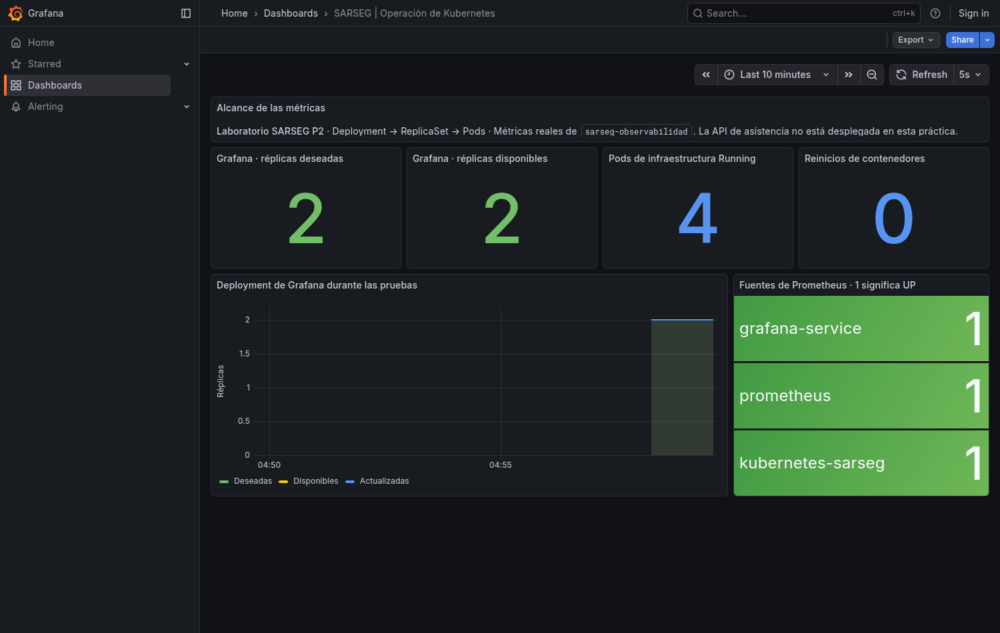
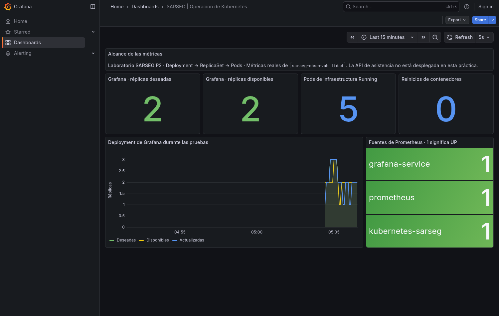

# Configuración de un clúster Kubernetes para SARSEG

Actividad 15% P2. Autor del repositorio: JOURT1. Fecha: 11/11/2026.

Repositorio público: https://github.com/JOURT1/SARSEG-Kubernetes-P2

Informe con las figuras y el detalle de la práctica: [PDF](../output/pdf/Informe-SARSEG-Kubernetes-P2.pdf).

## Objetivo y alcance

Se despliega Grafana, plataforma diferente al Nginx del primer Pod de clase, con
Deployment, ReplicaSet y Service NodePort. Se utilizan imágenes oficiales y no
se copia el código privado de SARSEG. El contexto es el monitoreo operativo de
un sistema de asistencia con API .NET, PostgreSQL e Ionic/Angular.

## Configuración

- kind 0.27.0 con Kubernetes 1.32.2, un control plane y dos workers.
- Namespace sarseg-observabilidad.
- Grafana 12.3.0, dos réplicas distribuidas entre workers.
- RollingUpdate, maxSurge=1, maxUnavailable=0, probes de /api/health.
- preStop de diez segundos y gracia de treinta segundos.
- NodePort 30300 mapeado a http://127.0.0.1:13000.
- Prometheus 3.5.0 y kube-state-metrics 2.16.0; RBAC de lectura del namespace.
- ConfigMaps generados con Kustomize y dashboard provisionado de solo lectura.

## Resultado de la ejecución final

- 11 comprobaciones aprobadas.
- Tres nodos Ready y dos réplicas disponibles al cierre.
- Escalado 2 a 3 a 2 sin cambiar el UID del ReplicaSet.
- Reposición de grafana-5c4c8dcb6c-6rchm por grafana-5c4c8dcb6c-sclrn con UID diferente.
- Recuperación medida en aproximadamente 15.64 segundos.
- Rollout desde grafana-5c4c8dcb6c a grafana-557d55f7c.
- Rollback que reactiva grafana-5c4c8dcb6c y restaura la plantilla v1.
- 113/113 muestras HTTP 200 y database=ok durante las pruebas.

La actualización cambia una anotación de spec.template y conserva la misma
imagen de Grafana. El muestreo aproximadamente cada segundo no garantiza
disponibilidad entre solicitudes.

## Capturas reales

Son exportaciones reales de la interfaz mediante Grafana Image Renderer. Los
registros de kubectl están en TXT y JSON; no se presentan como capturas.

## Hallazgo y mejora

La primera ejecución registró 110/111
solicitudes correctas y un RemoteDisconnected durante el rollout. El resultado
no aprobado se conserva en evidencias/ejecucion. Se agregó preStop para dar
tiempo al drenaje y se repitió el protocolo completo, conservando la ejecución
final por separado. Véase [incidencias](INCIDENCIAS.md).

## Usos y límites

Grafana puede mostrar latencia y errores HTTP, generación de reportes y estado
de PostgreSQL cuando se instrumente SARSEG. En esta entrega solo se observan
recursos reales de infraestructura; la API privada no está desplegada.

Dos Pods permiten demostrar reposición y actualizaciones. La computadora y el
control plane siguen siendo puntos únicos de fallo. Grafana usa SQLite efímera
independiente y configuración reconstruida desde Git; Prometheus es efímero.
Alta disponibilidad productiva requiere una base compartida y otro diseño de
autenticación, almacenamiento y redundancia.

## Historial y reproducción

Se conservan main y cuatro ramas de avance, con commits y PR separados:
[infraestructura](https://github.com/JOURT1/SARSEG-Kubernetes-P2/pull/1), [métricas](https://github.com/JOURT1/SARSEG-Kubernetes-P2/pull/2),
[pruebas](https://github.com/JOURT1/SARSEG-Kubernetes-P2/pull/3), [informe](https://github.com/JOURT1/SARSEG-Kubernetes-P2/pull/4).

Inicio: `scripts/Start-Lab.ps1`. Prueba nueva: `python scripts/test_lab.py --output tmp/repeticion`.
Consulte [reproducción](REPRODUCCION.md), [arquitectura](ARQUITECTURA.md),
[métricas](METRICAS.md), [pruebas](PRUEBAS.md) y [evidencias](evidencias/README.md).

## Referencias

- [Kubernetes Deployments](https://kubernetes.io/docs/concepts/workloads/controllers/deployment/)
- [Kubernetes ReplicaSet](https://kubernetes.io/docs/concepts/workloads/controllers/replicaset/)
- [kind Configuration](https://kind.sigs.k8s.io/docs/user/configuration/)
- [Grafana Provisioning](https://grafana.com/docs/grafana/latest/administration/provisioning/)
- [Grafana High availability](https://grafana.com/docs/grafana/latest/setup-grafana/set-up-for-high-availability/)
- [Grafana Image rendering](https://grafana.com/docs/grafana/latest/setup-grafana/image-rendering/)

Material de clase consultado: Intro Kubernetes, Intro Docker, CD Intro e Intro
Entrega Continua CD. No se redistribuyen los PDFs originales.
