# Configuración de un clúster Kubernetes y despliegue de Grafana para SARSEG con Deployment y ReplicaSet

Jhoel Suárez

Universidad de Las Américas · Ingeniería de Software

Asignatura: Procesos de Software

Docente: Mónica Fernanda Sanchez Rosero

11 de noviembre de 2026

## Configuración de un clúster Kubernetes y despliegue de Grafana para SARSEG con Deployment y ReplicaSet

El presente informe documenta el despliegue de Grafana en un clúster local de Kubernetes para el contexto de SARSEG, sistema de registro de asistencia con API .NET, PostgreSQL e interfaz Ionic/Angular. La práctica aplica Deployment y ReplicaSet, comprueba la ejecución de los Pods y expone la plataforma mediante un Service NodePort. La secuencia incluye preparación, configuración, despliegue, acceso, escalado, recuperación, actualización y reversión.

Se eligió Grafana porque es una plataforma distinta del Nginx utilizado como primer Pod en el material de clase (<i>Intro Kubernetes</i>, s. f.). Grafana permite visualizar métricas operativas y relacionarlas con el funcionamiento de un sistema. En esta entrega se observan recursos reales de la infraestructura del laboratorio; la API privada de SARSEG no se despliega ni se presenta como instrumentada.

El objetivo es demostrar cómo un Deployment administra ReplicaSets y cómo estos mantienen el número de Pods deseado. Se entrega un informe con capturas de principio a fin, configuración reproducible, interpretación de resultados, usos y enlace a un repositorio público con ramas y commits por avance.

Repositorio público: https://github.com/JOURT1/SARSEG-Kubernetes-P2

## Fundamento técnico

Un Pod agrupa los contenedores que Kubernetes programa y ejecuta en un nodo. En esta práctica cada Pod de Grafana contiene una instancia de la imagen grafana/grafana:12.3.0. Se exige que esté Ready para recibir tráfico; observar únicamente el estado Running no demuestra disponibilidad de la aplicación (Kubernetes, s. f.-b).

Deployment declara la cantidad de réplicas y la plantilla de los Pods. También coordina las revisiones y la actualización gradual. El laboratorio establece dos réplicas, RollingUpdate, maxSurge de uno y maxUnavailable de cero. Cambiar spec.template genera una revisión, mientras que escalar modifica la cantidad deseada sin cambiar la plantilla (Kubernetes, s. f.-a).

ReplicaSet mantiene el número de Pods de una plantilla mediante un selector. Su aplicación se comprueba con ownerReferences, escalado y reposición de un Pod con UID nuevo. No se crea otro ReplicaSet independiente con el mismo selector, porque el Deployment ya administra ese controlador (Kubernetes, s. f.-c).

Service proporciona un punto estable de acceso a los Pods seleccionados. Aquí el NodePort 30300 se comunica con el puerto 3000 de Grafana. kind publica ese NodePort en Windows mediante un mapeo de puerto limitado a loopback (Kubernetes, s. f.-d; Kubernetes SIGs, s. f.).

## Diseño y método de documentación

La implementación original permanece en el contexto kind-sarseg-p2 y el puerto 13000. Para capturar el inicio desde cero se realizó una reproducción separada: kind-sarseg-p2-evidencia y puerto 13010. Solo cambian el nombre del clúster y el puerto del equipo; los manifiestos de la plataforma y las versiones son los mismos. La Tabla 1 resume la configuración.

**Tabla 1. Componentes y decisiones de configuración**

| Componente | Configuración |

|---|---|

| Clúster | kind 0.27.0, Kubernetes 1.32.2, un control plane y dos workers |

| Namespace | sarseg-observabilidad |

| Grafana | Imagen 12.3.0 y dos réplicas distribuidas entre workers |

| Métricas | Prometheus 3.5.0 y kube-state-metrics 2.16.0 |

| Disponibilidad | Probes /api/health; minReadySeconds de cinco |

| Actualización | RollingUpdate; maxSurge: 1 y maxUnavailable: 0 |

| Terminación | preStop de diez segundos y gracia de treinta segundos |

| Exposición | NodePort 30300; localhost 13000 original o 13010 reproducción |

## Método y trazabilidad de la evidencia

Los tableros y las fuentes de datos se provisionan desde ConfigMaps versionados, siguiendo el mecanismo de configuración por archivos de Grafana (Grafana Labs, s. f.-a). El proceso registra las versiones utilizadas, crea el clúster, aplica los recursos, espera disponibilidad y ejecuta las pruebas de controladores y exposición.

Se conservan comandos, salidas, fechas UTC y estados JSON. Las capturas de la bitácora muestran esos registros en un visor de lectura; se distinguen de las capturas directas de GitHub y Grafana. Las imágenes del tablero durante las pruebas se exportan mediante el servicio oficial de renderizado de Grafana (Grafana Labs, s. f.-c).

Las evidencias de la primera implementación y las de la reproducción se mantienen separadas. Las referencias de propietario y los UIDs pertenecen a cada ejecución, por lo que no se combinan como si correspondieran al mismo Pod. El resultado se interpreta junto con los datos originales y no únicamente con una imagen.

El logotipo de la carátula se obtuvo del recurso institucional oficial de la Universidad de Las Américas (s. f.). Se conserva su proporción y color; su inclusión es la adaptación institucional solicitada para esta entrega académica.

## Correspondencia con la consigna

La Tabla 2 vincula cada requisito con una evidencia concreta. Las imágenes siguientes están ordenadas por el proceso de implementación, no por la fecha de consulta de una página del repositorio.

**Tabla 2. Requisitos y evidencias verificables**

| Requisito | Cumplimiento y evidencia |

|---|---|

| Plataforma distinta de la vista en clase | Grafana; imagen, Pods Ready y tablero visible |

| Aplicar Deployment | Manifiesto, dos réplicas, actualización y rollback |

| Aplicar ReplicaSet | Propietario de Pods, mismo controlador al escalar y reposición con UID nuevo |

| Indicar usos | Monitoreo de infraestructura y usos propuestos para SARSEG |

| Repositorio público | Enlace accesible sin autenticación y captura de la etiqueta Public |

| Capturas de todo el proceso | Requisitos, creación, configuración, despliegue, acceso y pruebas |

| Evidenciar configuración y exposición | YAML, kubectl apply, estado Ready, Service y respuesta HTTP |

| Ramas y commits por avance | Ramas preservadas, mensajes de commits y pull requests separados |

Las capturas acreditan visibilidad, comandos y funcionamiento. Los archivos originales y sus hashes permiten contrastar cada figura con el registro conservado en docs/evidencias (Suárez, 2026).

### Paso 1 Acceso al repositorio público

Se creó el repositorio de la práctica. En la Figura 1 se observa su visibilidad Public, la estructura de carpetas y el acceso al código y a las evidencias.

**Figura 1**

*Repositorio público de la práctica*

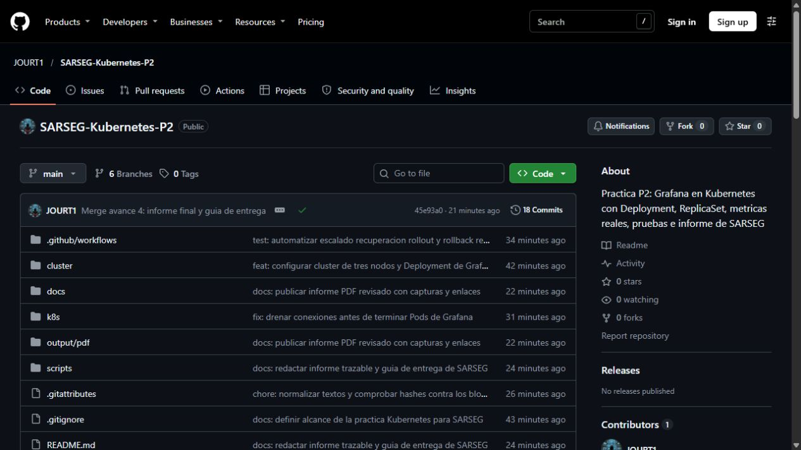

Nota. Captura de GitHub consultado sin iniciar sesión. El enlace está incluido al comienzo del informe.

### Paso 2 Organización por ramas

Los avances se separaron en infraestructura, métricas, pruebas e informe. Se conservaron las ramas y se agregó una rama para esta ampliación documental; cada cambio mantiene su propio historial (Figura 2).

**Figura 2**

*Ramas conservadas por avance*

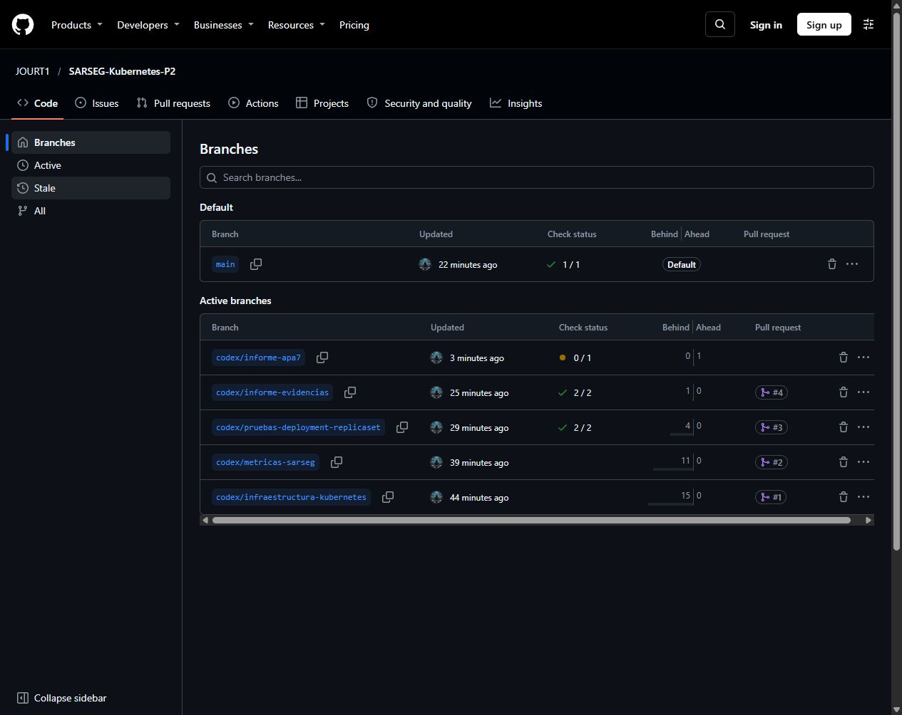

Nota. Captura de la vista Branches. Las referencias de los pull requests permiten revisar las integraciones.

### Paso 3 Historial de commits

El historial registra cambios de configuración, automatización, correcciones y entrega. Esta separación permite reconocer qué se modificó y evita concentrar toda la actividad en un único commit (Figura 3).

**Figura 3**

*Historial de cambios y merges*

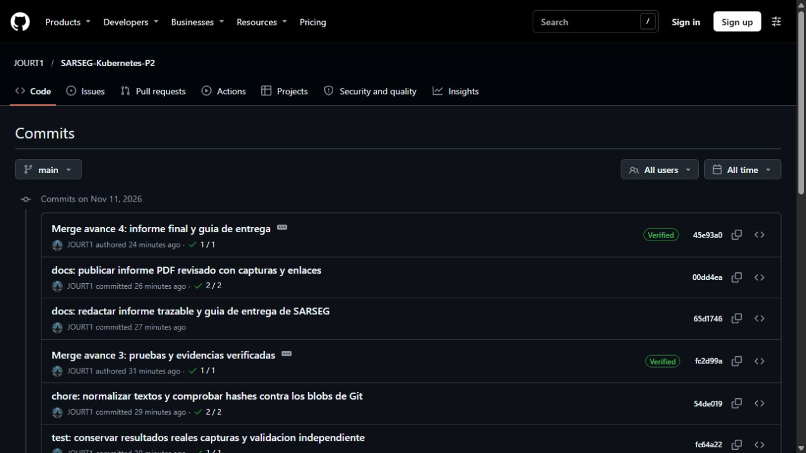

Nota. Fragmento del historial de main. El repositorio conserva los commits completos y sus fechas reales.

### Paso 4 Verificación de requisitos

Se verificaron Docker Server 28.1.1, kind 0.27.0 y kubectl 1.32.2. Esta comprobación confirma que existe un motor Linux accesible antes de crear los nodos (Figura 4).

**Figura 4**

*Verificación de requisitos*

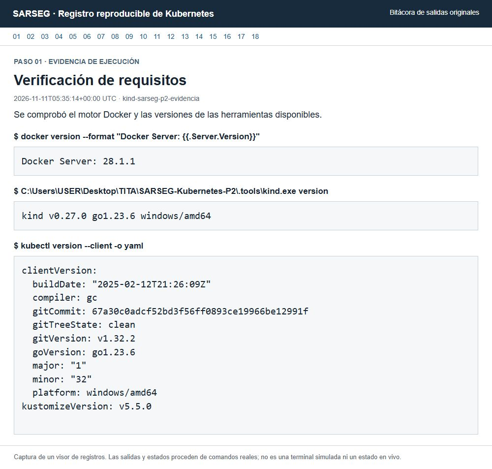

Nota. Captura del visor de la bitácora del paso 01. La salida original se conserva en pasos.json.

### Paso 5 Definición del clúster

El archivo declara un control plane y dos workers. extraPortMappings une NodePort 30300 con el puerto local 13010, limitado a 127.0.0.1 para la reproducción (Figura 5).

**Figura 5**

*Configuración del clúster*

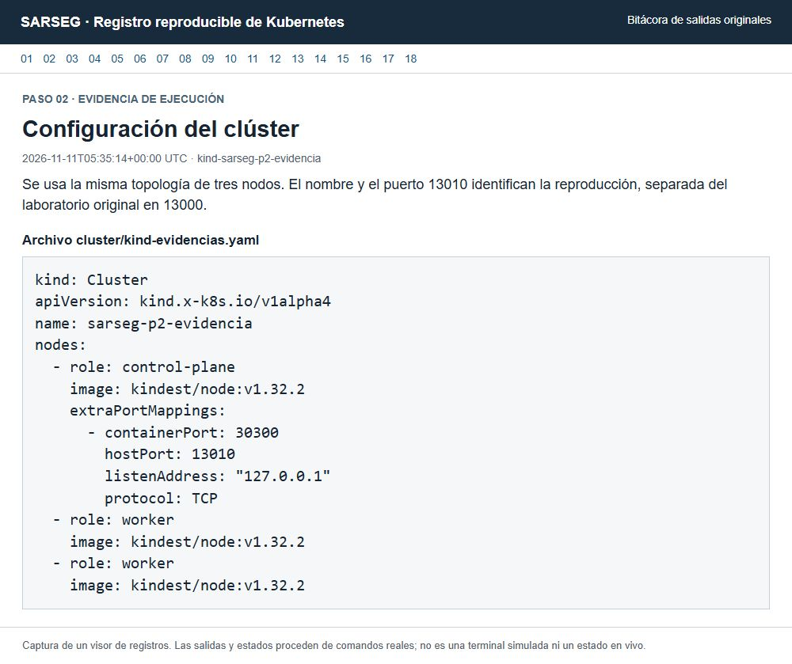

Nota. Captura del visor de la bitácora del paso 02. La salida original se conserva en pasos.json.

### Paso 6 Creación desde cero

Se ejecutó kind create cluster con el archivo de evidencias. La salida registra preparación de nodos, inicio del control plane, red, unión de workers y estado listo (Figura 6).

**Figura 6**

*Creación real del clúster desde cero*

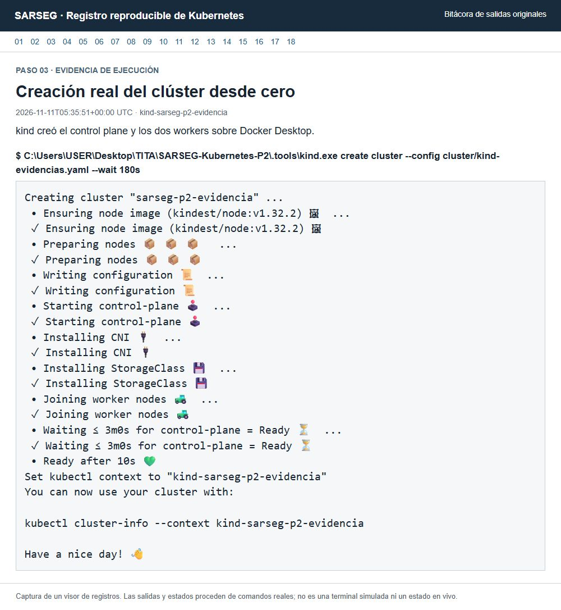

Nota. Captura del visor de la bitácora del paso 03. La salida original se conserva en pasos.json.

### Paso 7 Verificación de nodos Ready

Antes de desplegar la plataforma se consultó kubectl get nodes. Los tres nodos aparecen Ready y utilizan Kubernetes 1.32.2; crear el clúster no sustituye esta comprobación (Figura 7).

**Figura 7**

*Comprobación de los tres nodos*

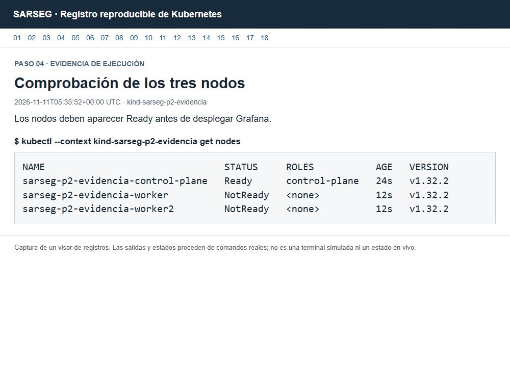

Nota. Captura del visor de la bitácora del paso 04. La salida original se conserva en pasos.json.

### Paso 8 Configuración del Deployment

El manifiesto declara replicas: 2, selector app=grafana y estrategia RollingUpdate. El selector coincide con las etiquetas de la plantilla, condición necesaria para administrar los Pods correctos (Figura 8).

**Figura 8**

*Definición del Deployment*

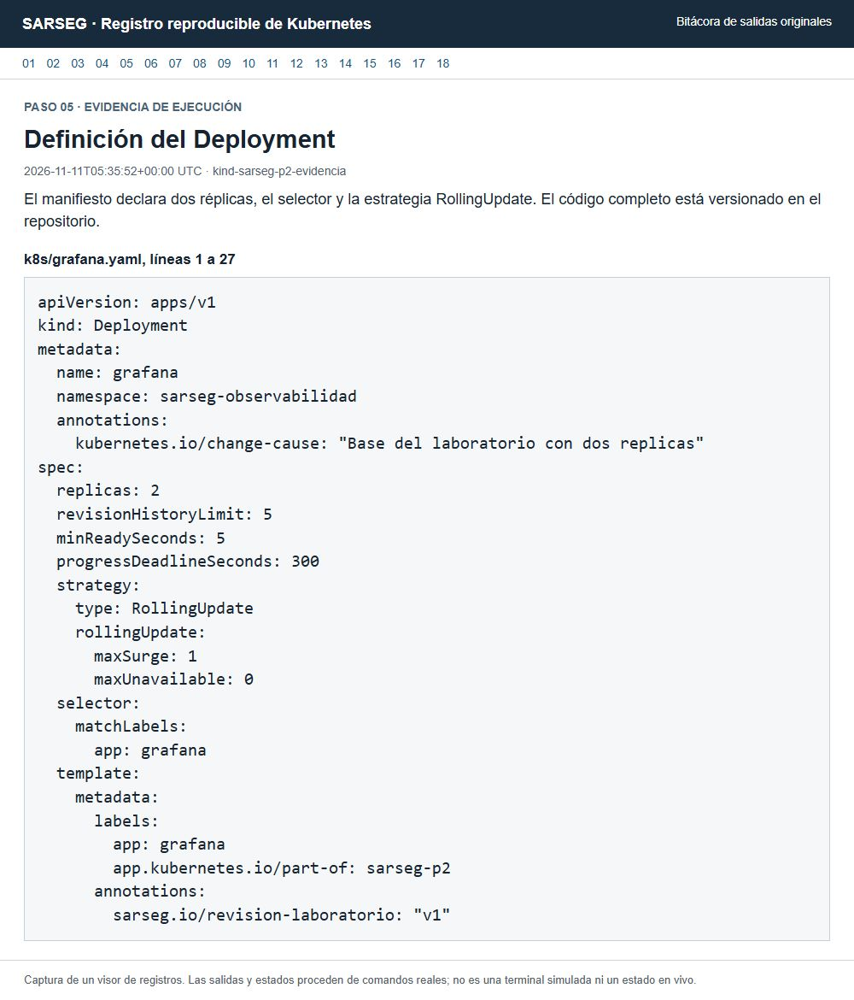

Nota. Captura del visor de la bitácora del paso 05. La salida original se conserva en pasos.json.

### Paso 9 Aplicación de los recursos

kubectl apply -k k8s creó el namespace, permisos de lectura, ConfigMaps, Services y Deployments. La configuración declarativa permite repetir el despliegue desde los mismos archivos (Figura 9).

**Figura 9**

*Aplicación de los manifiestos*

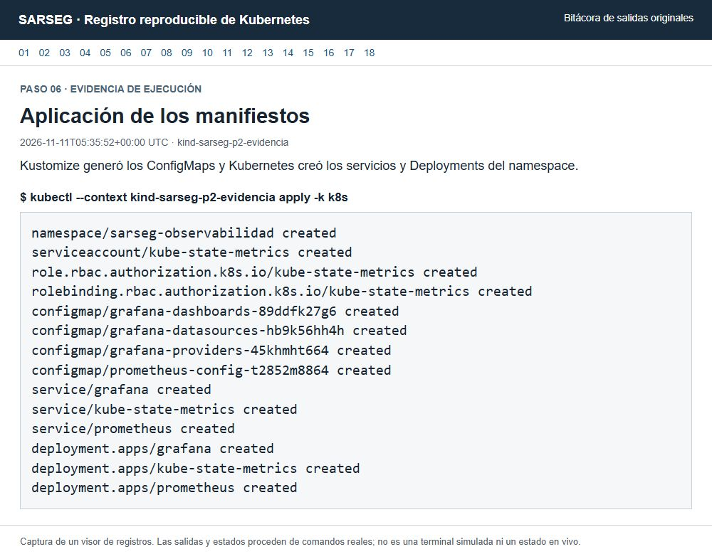

Nota. Captura del visor de la bitácora del paso 06. La salida original se conserva en pasos.json.

### Paso 10 Espera de disponibilidad

Se esperó el rollout de Grafana, Prometheus y kube-state-metrics. La comprobación exige réplicas disponibles y evita declarar éxito cuando solo existen objetos creados o contenedores arrancando (Figura 10).

**Figura 10**

*Espera de disponibilidad*

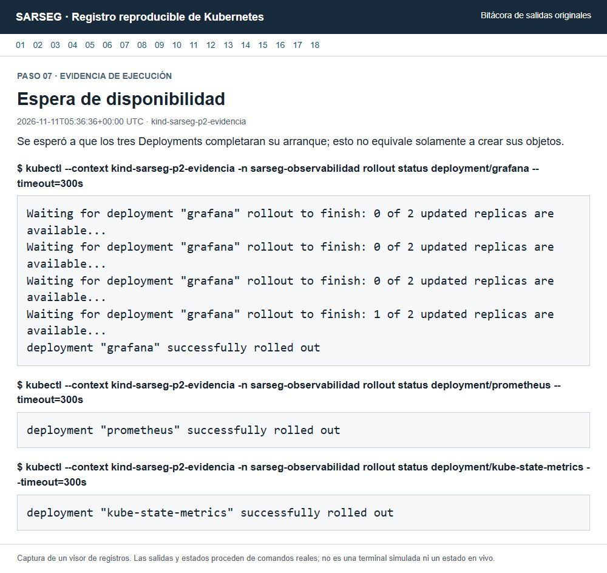

Nota. Captura del visor de la bitácora del paso 07. La salida original se conserva en pasos.json.

### Paso 11 Comprobación de Deployment y ReplicaSet

Grafana muestra dos réplicas disponibles. Su ReplicaSet presenta DESIRED, CURRENT y READY iguales a dos; el script también comprueba la propiedad del controlador mediante ownerReferences (Figura 11).

**Figura 11**

*Deployment y ReplicaSet disponibles*

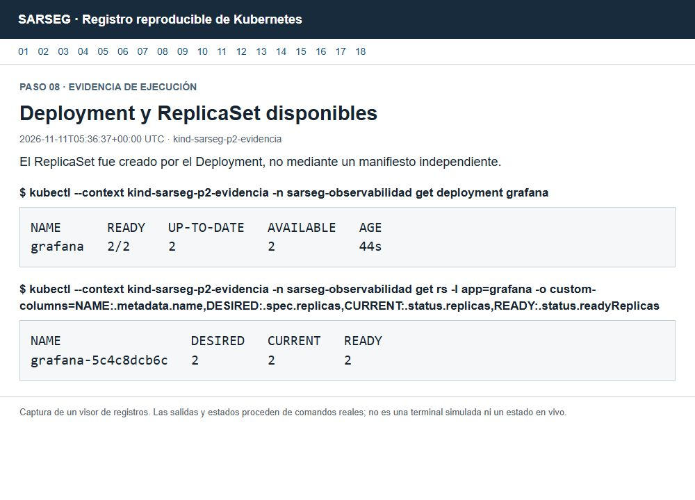

Nota. Captura del visor de la bitácora del paso 08. La salida original se conserva en pasos.json.

### Paso 12 Comprobación de los Pods

Los dos Pods de Grafana aparecen Ready y se distribuyen en workers distintos. El reparto procede de la afinidad y de la restricción de distribución definidas en el Deployment (Figura 12).

**Figura 12**

*Pods distribuidos en los workers*

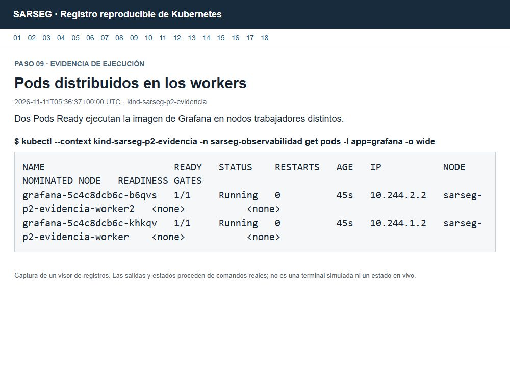

Nota. Captura del visor de la bitácora del paso 09. La salida original se conserva en pasos.json.

### Paso 13 Configuración de Service

El Service NodePort selecciona app=grafana, publica el puerto 3000 y reserva NodePort 30300. El mapeo de kind permite acceder desde Windows sin ejecutar port-forward (Figura 13).

**Figura 13**

*Definición de la exposición*

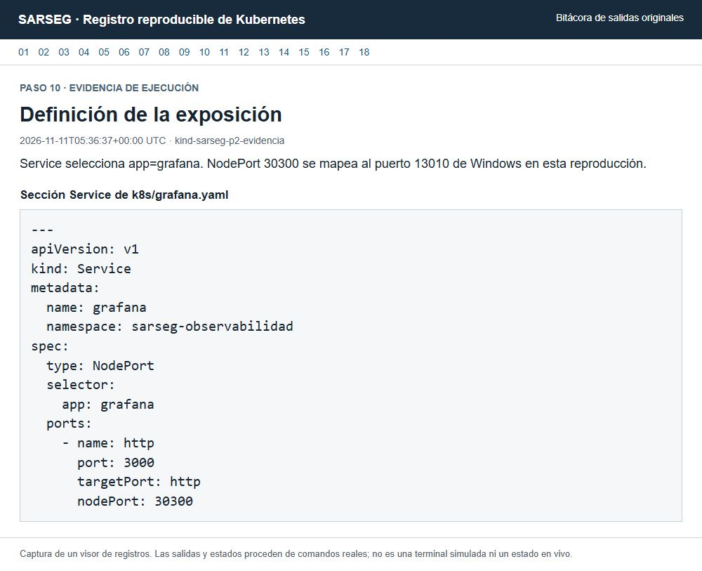

Nota. Captura del visor de la bitácora del paso 10. La salida original se conserva en pasos.json.

### Paso 14 Validación del acceso HTTP

Se consultó el Service y se solicitó /api/health a través de 127.0.0.1:13010. La respuesta HTTP 200 y database: ok acreditan acceso desde el equipo a la plataforma expuesta (Figura 14).

**Figura 14**

*Plataforma expuesta por HTTP*

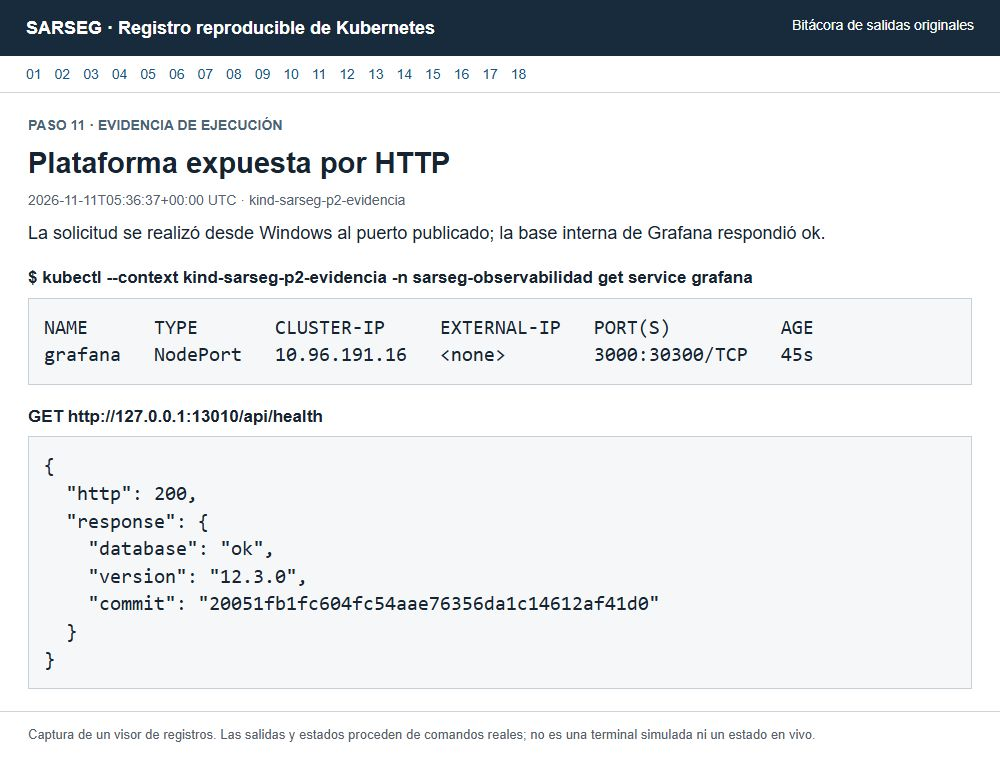

Nota. Captura del visor de la bitácora del paso 11. La salida original se conserva en pasos.json.

### Paso 15 Consulta directa del endpoint

El endpoint de salud se abrió también en el navegador. La respuesta identifica Grafana 12.3.0 y confirma el estado de su base interna; no representa la salud de la API privada de SARSEG (Figura 15).

**Figura 15**

*Respuesta real de salud de Grafana*

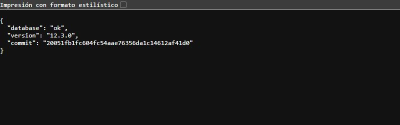

Nota. Captura directa de /api/health en el puerto de la reproducción. El código HTTP se conserva en la bitácora.

### Paso 16 Apertura de la plataforma

Grafana cargó el tablero provisionado con dos réplicas deseadas y disponibles. Prometheus recoge métricas reales del namespace; las fuentes activas aparecen con valor uno (Figura 16).

**Figura 16**

*Tablero inicial de Grafana*

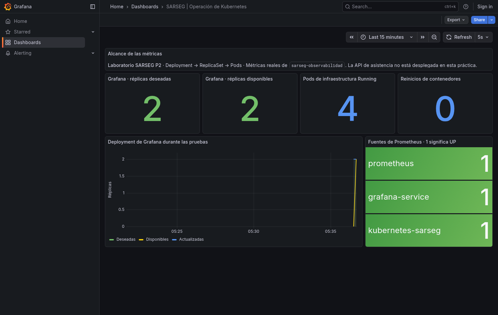

Nota. Exportación real de Grafana Image Renderer durante la reproducción; no se emplean métricas de negocio simuladas.

### Paso 17 Ejecución del protocolo

Se ejecutó test_lab.py con contexto y puerto explícitos. El protocolo conserva once comprobaciones: clúster, propiedad, exposición, métricas, RBAC, escalado, recuperación, actualización, rollback y muestreo HTTP (Figura 17).

**Figura 17**

*Ejecución del protocolo completo*

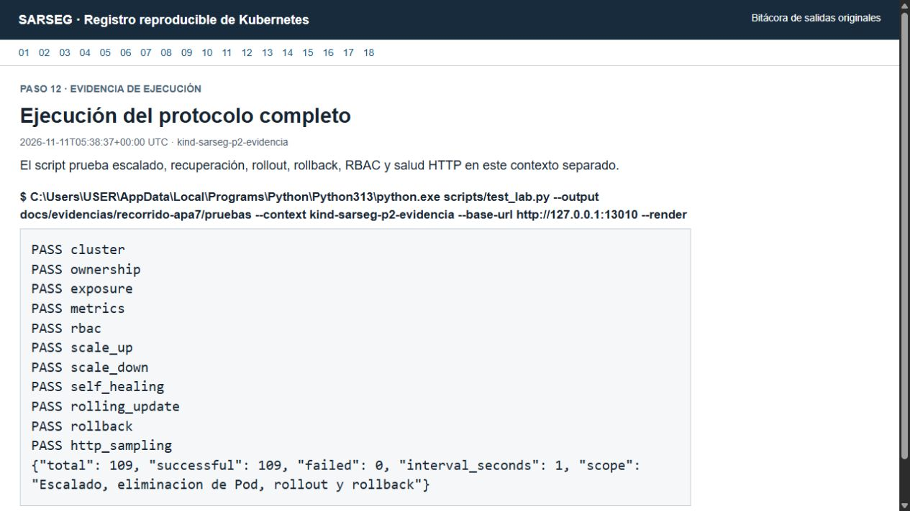

Nota. Captura del visor de la bitácora del paso 12. La salida original se conserva en pasos.json.

### Paso 18 Escalado a tres réplicas

kubectl scale elevó Grafana de dos a tres Pods Ready. El UID del ReplicaSet se mantuvo: cambió la cantidad deseada, pero no la plantilla del Deployment (Figura 18).

**Figura 18**

*Escalado de dos a tres réplicas*

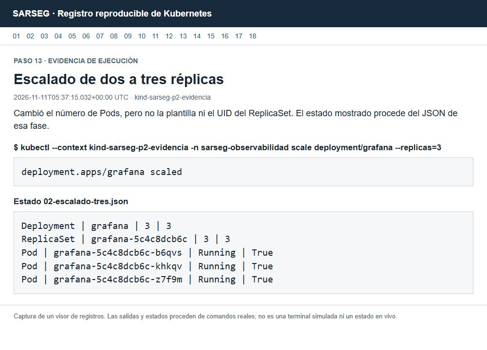

Nota. Captura del visor de la bitácora del paso 13. La salida original se conserva en pasos.json.

### Paso 19 Observación del escalado

El tablero mostró tres réplicas deseadas y disponibles después de esperar el estado Ready. La variación del gráfico corresponde al cambio aplicado en Kubernetes y recogido por Prometheus (Figura 19).

**Figura 19**

*Grafana con tres réplicas*

Nota. Exportación tomada durante la fase de escalado. El estado JSON de la misma fase está preservado.

### Paso 20 Restauración de dos réplicas

Se redujo el Deployment a dos réplicas y se verificó que ambas quedaran disponibles. La reducción controlada permite observar el ajuste al estado deseado antes de la prueba de recuperación (Figura 20).

**Figura 20**

*Retorno a dos réplicas*

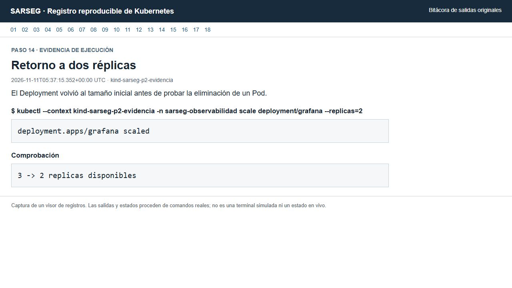

Nota. Captura del visor de la bitácora del paso 14. La salida original se conserva en pasos.json.

### Paso 21 Reposición de un Pod

Se eliminó un Pod de prueba y ReplicaSet creó otro con un UID diferente. El registro conserva el objeto eliminado, su reemplazo y el tiempo hasta recuperar dos réplicas disponibles (Figura 21).

**Figura 21**

*Reposición automática del Pod eliminado*

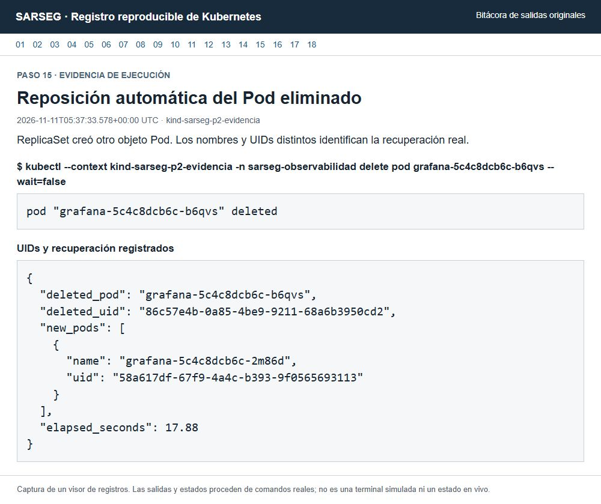

Nota. Captura del visor de la bitácora del paso 15. La salida original se conserva en pasos.json.

### Paso 22 Actualización gradual

Se cambió la anotación de spec.template de v1 a v2-prueba-p2. El Deployment creó un ReplicaSet nuevo y completó RollingUpdate; la imagen continuó siendo Grafana 12.3.0 (Figura 22).

**Figura 22**

*Actualización de la plantilla*

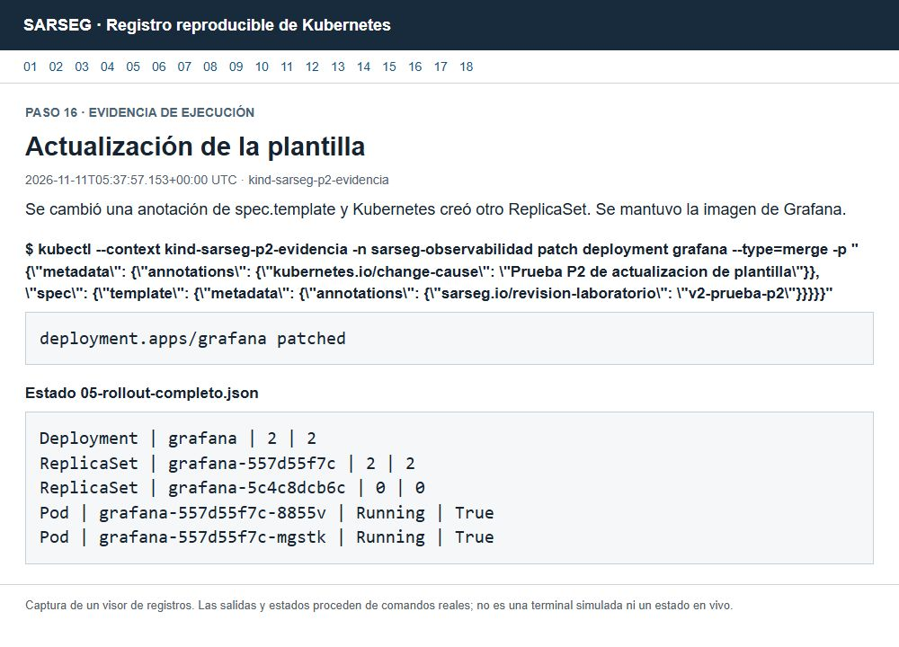

Nota. Captura del visor de la bitácora del paso 16. La salida original se conserva en pasos.json.

### Paso 23 Rollback

rollout undo restauró la revisión inicial de esta reproducción. El ReplicaSet original volvió a dos réplicas y el de la plantilla de prueba quedó en cero, conservado para el historial (Figura 23).

**Figura 23**

*Rollback de la revisión*

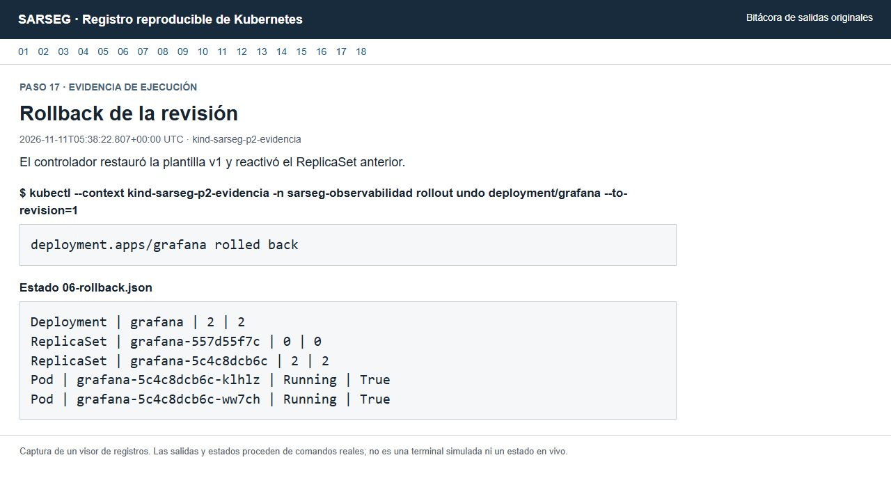

Nota. Captura del visor de la bitácora del paso 17. La salida original se conserva en pasos.json.

### Paso 24 Verificación final en Grafana

Después del rollback se comprobó nuevamente el tablero en el navegador. Se observan dos réplicas disponibles, cuatro Pods de infraestructura y las tres fuentes activas (Figura 24).

**Figura 24**

*Grafana después de la reversión*

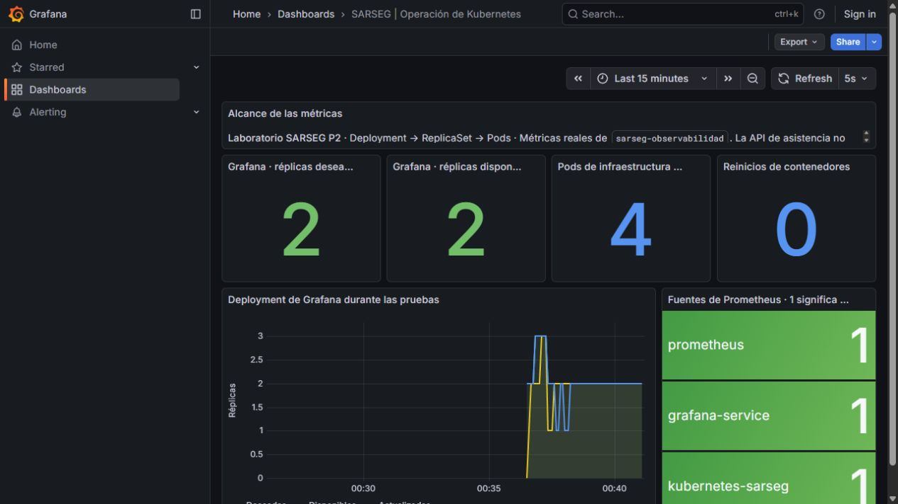

Nota. Captura directa del navegador al concluir el recorrido. El historial del gráfico conserva las variaciones de las pruebas.

### Paso 25 Revisión del resultado registrado

El archivo final confirma once comprobaciones aprobadas y 109 de 109 solicitudes HTTP correctas. Se conserva cada muestra y se comprueba el resultado del protocolo, además de observar las capturas (Figura 25).

**Figura 25**

*Resultados y exposición final*

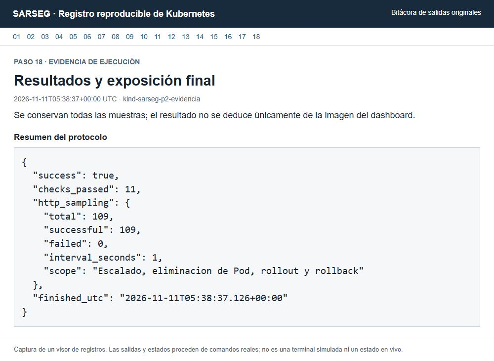

Nota. Captura del visor de la bitácora del paso 18. La salida original se conserva en pasos.json.

### Paso 26 Verificación independiente en CI

GitHub Actions creó otro clúster en Linux y ejecutó el protocolo. La ejecución mostrada terminó correctamente y conserva su artefacto de registros; es una validación separada de la computadora Windows (Figura 26).

**Figura 26**

*Ejecución exitosa de GitHub Actions*

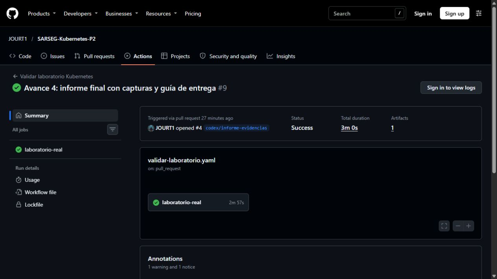

Nota. Captura de una ejecución pública del workflow. El enlace permite consultar la conclusión y el artefacto.

## Resultados e interpretación

La Tabla 3 resume los resultados de la reproducción documentada.

**Tabla 3. Resultados de la reproducción documentada**

| Prueba | Resultado observado |

|---|---|

| Clúster | Tres nodos Ready |

| Estado inicial y final | Dos réplicas disponibles en workers distintos |

| Escalado | Dos a tres y retorno a dos; mismo UID de ReplicaSet |

| Recuperación | Pod nuevo con UID diferente; 17.88 segundos medidos |

| Actualización | Nuevo ReplicaSet grafana-557d55f7c |

| Rollback | Reactivación de grafana-5c4c8dcb6c |

| HTTP | 109 de 109 muestras con HTTP 200 y database: ok |

| Permisos | kube-state-metrics puede listar Pods y no puede listar Secrets |

La implementación original tuvo una primera ejecución con 110 respuestas correctas de 111 y un RemoteDisconnected durante el rollout. Se añadió preStop de diez segundos para permitir el drenaje y se repitió el protocolo: la ejecución original final obtuvo 113 de 113 respuestas correctas. La reproducción de las figuras obtuvo 109 de 109. Son ejecuciones distintas, identificadas por contexto y fechas; no se mezclan sus UIDs ni sus mediciones.

Se midió la salud aproximadamente cada segundo. Las muestras correctas no garantizan continuidad entre solicitudes. El cambio de plantilla prueba el rollout y el rollback; la imagen de Grafana mantuvo la versión 12.3.0.

## Usos de la plataforma en SARSEG

En el alcance implementado, Grafana muestra réplicas deseadas, disponibles y actualizadas, cantidad de Pods de infraestructura, reinicios y disponibilidad de las fuentes. Esto permite reconocer si un cambio de configuración se completó y si el sistema recuperó la cantidad esperada de instancias. La Tabla 4 distingue esos usos de las ampliaciones propuestas.

**Tabla 4. Usos actuales y ampliaciones posibles**

| Uso | Aplicación al sistema de asistencia | Estado |

|---|---|---|

| Infraestructura | Réplicas, Pods, reinicios y recuperación de Grafana | Implementado |

| Atención de solicitudes | Latencia y errores HTTP de la API .NET | Requiere instrumentar SARSEG |

| Reportes | Duración y fallos de generación de PDF o XLSX | Propuesto |

| Base de datos | Conexiones, consultas lentas y errores de PostgreSQL | Propuesto |

| Capacidad | Correlación con picos de entrada o salida de asistencia | Propuesto |

Los usos futuros requieren métricas de la API y de sus dependencias. No se presentan marcas individuales, datos personales ni indicadores de estudiantes. La incorporación de SARSEG a este monitoreo debe distinguirse de la demostración de los controladores de Kubernetes, que sí fue ejecutada.

## Limitaciones y conclusiones

El laboratorio depende de una computadora, Docker Desktop y un único control plane por clúster. Las dos réplicas permiten demostrar reposición y actualización de Pods, pero no representan tolerancia al fallo del equipo. Prometheus usa una réplica y almacenamiento efímero; su historial se pierde si se elimina el entorno.

Grafana utiliza SQLite independiente y efímera por Pod, mientras los dashboards y la fuente de datos se reconstruyen desde ConfigMaps. No se habilitan ediciones de tableros ni alertas persistentes. Una instalación productiva de Grafana con alta disponibilidad requiere una base PostgreSQL o MySQL compartida y un diseño de autenticación, almacenamiento y redundancia (Grafana Labs, s. f.-b).

La actividad cumple los requisitos de desplegar una plataforma distinta del ejemplo de clase, aplicar Deployment y ReplicaSet, explicar usos y entregar configuración y capturas con repositorio público. La secuencia muestra creación del clúster, disponibilidad, exposición, escalado, reposición y reversión. Las evidencias originales y la reproducción documentada permiten verificar tanto el estado deseado como el comportamiento real de Kubernetes.

Los manifiestos están en cluster y k8s; los scripts están en scripts; las capturas, los estados y los comandos se encuentran en docs/evidencias. SHA256SUMS.txt permite contrastar los archivos. Las ramas y los pull requests preservan los avances y las correcciones, incluida esta ampliación del informe.

## Referencias

Grafana Labs. (s. f.-a). <i>Provision Grafana</i>. Recuperado el 11 de noviembre de 2026, de https://grafana.com/docs/grafana/latest/administration/provisioning/

Grafana Labs. (s. f.-b). <i>Set up Grafana for high availability</i>. Recuperado el 11 de noviembre de 2026, de https://grafana.com/docs/grafana/latest/setup-grafana/set-up-for-high-availability/

Grafana Labs. (s. f.-c). <i>Set up image rendering</i>. Recuperado el 11 de noviembre de 2026, de https://grafana.com/docs/grafana/latest/setup-grafana/image-rendering/

<i>Intro Kubernetes</i>. (s. f.). [Diapositivas de clase]. Procesos de Software, UDLA Brightspace. https://udla.brightspace.com/d2l/home/870697

Kubernetes. (s. f.-a). <i>Deployments</i>. Recuperado el 11 de noviembre de 2026, de https://kubernetes.io/docs/concepts/workloads/controllers/deployment/

Kubernetes. (s. f.-b). <i>Pods</i>. Recuperado el 11 de noviembre de 2026, de https://kubernetes.io/docs/concepts/workloads/pods/

Kubernetes. (s. f.-c). <i>ReplicaSet</i>. Recuperado el 11 de noviembre de 2026, de https://kubernetes.io/docs/concepts/workloads/controllers/replicaset/

Kubernetes. (s. f.-d). <i>Service</i>. Recuperado el 11 de noviembre de 2026, de https://kubernetes.io/docs/concepts/services-networking/service/

Kubernetes SIGs. (s. f.). <i>Configuration</i>. kind. Recuperado el 11 de noviembre de 2026, de https://kind.sigs.k8s.io/docs/user/configuration/

Suárez, J. (2026). <i>SARSEG Kubernetes P2</i> [Repositorio de código y evidencias]. GitHub. https://github.com/JOURT1/SARSEG-Kubernetes-P2

Universidad de Las Américas. (s. f.). <i>Marca UDLA</i>. https://www.udla.edu.ec/la-udla/marca-udla/