# Automatización de la configuración continua de SARSEG mediante Spinnaker y Kubernetes

Jhoel Suarez

Universidad de Las Américas · Ingeniería de Software

Asignatura: Procesos de Software

Docente: Mónica Fernanda Sanchez Rosero

20 de noviembre de 2026

## Automatización de la configuración continua de SARSEG mediante Spinnaker y Kubernetes

El presente informe documenta el despliegue automatizado de SARSEG en Kubernetes mediante Spinnaker. Se adapta la consigna de Argo CD a la herramienta solicitada, conservando Git como fuente de los manifiestos Deployment, Service NodePort y Horizontal Pod Autoscaler. La implementación incluye web Ionic/Angular, API ASP.NET Core y PostgreSQL de prueba (JOURT1, 2026b).

La evidencia comprende preparación, configuración, registro de la aplicación, ejecución del pipeline, publicación de un cambio Git y escalamiento por consumo real de CPU. Los resultados originales conservan once comprobaciones aprobadas y la secuencia de réplicas 2 a 5 y de regreso a 2 (JOURT1, 2026a).

Implementar y verificar el despliegue automatizado de SARSEG desde Git mediante Spinnaker, usando recursos Kubernetes declarativos y escalamiento horizontal basado en CPU.

Configurar dos réplicas iniciales con recursos de CPU y memoria; exponer la aplicación por NodePort; habilitar Metrics Server y un HPA entre dos y cinco réplicas al 50% de CPU; comprobar el despliegue de un cambio Git y documentar cada paso con capturas y referencias.

## Fundamento técnico y adaptación de la consigna

Un Deployment declara la plantilla y las réplicas de los Pods y administra sus revisiones (Kubernetes, s. f.-a). Un Service proporciona acceso estable a los Pods seleccionados; aquí se utiliza NodePort (Kubernetes, s. f.-d). El HPA ajusta las réplicas según métricas y calcula la utilización de CPU respecto de los requests configurados (Kubernetes, s. f.-b, s. f.-c).

Spinnaker ejecuta el despliegue mediante un pipeline y su integración Kubernetes. Las etapas Deploy (Manifest) recuperan los archivos como artefactos HTTP. La referencia de cada archivo incorpora un SHA completo para que toda la ejecución use la misma revisión de Git (Spinnaker, s. f.-a, s. f.-b).

Spinnaker no incorpora el mismo controlador Automated Sync de Argo CD. Se implementó un adaptador que consulta Git cada 20 segundos y solicita a Gate una ejecución cuando cambian los manifiestos. No ejecuta kubectl ni aplica recursos: el despliegue corresponde a Orca y Clouddriver. No se implementan corrección periódica de cambios manuales ni eliminación automática de recursos retirados de Git (JOURT1, 2026b).

La anotación strategy.spinnaker.io/use-source-capacity conserva las réplicas existentes en despliegues posteriores. Así, Spinnaker no restablece dos instancias mientras el HPA administra la capacidad bajo carga (Spinnaker, s. f.-b).

## Método de implementación y documentación

Se utilizó un clúster kind independiente dentro de Docker Desktop, sin crear servicios de nube. La plataforma mínima se basó en el instalador oficial de Spinnaker 2026.4.1. La Tabla 1 resume la configuración (Docker, s. f.; Kubernetes SIGs, s. f.-a; Spinnaker, 2026).

**Tabla 1. Componentes y parámetros del laboratorio**

| Componente | Configuración |

|---|---|

| Clúster | sarseg-spinnaker; Kubernetes v1.32.2; kind v0.27.0 |

| Spinnaker | 2026.4.1; Deck, Gate, Orca, Clouddriver y Front50 |

| Apoyo | MySQL, Redis, API SARSEG y PostgreSQL de prueba |

| Deployment web | Dos réplicas iniciales; puerto http/8080 |

| Requests / limits | CPU 25m / 250m; memoria 32Mi / 128Mi |

| Service | NodePort 30380; port 80; targetPort http |

| HPA | Mínimo 2; máximo 5; CPU 50%; reducción estable 60 s |

| Acceso local | SARSEG 14800; Gate 14884; Deck 14900 |

Las pruebas funcionales se realizaron entre el 19 y el 20 de noviembre de 2026. La ampliación documental se tomó el día 20. Se repitió la prueba de carga para capturar directamente las pantallas del HPA en dos, cinco y nuevamente dos réplicas. Todas las figuras de esta edición proceden de interfaces reales de GitHub, Spinnaker, Headlamp o SARSEG; no se utilizan visores documentales ni capturas de código. El índice registra URL, fecha UTC y huella SHA-256 de cada imagen.

Se adopta carátula estudiantil, márgenes de 2,54 cm, Times New Roman de 12 puntos, interlineado doble, paginación superior y referencias con sangría francesa. Las figuras tienen número, título en cursiva y nota de fuente (American Psychological Association, s. f.-a, s. f.-b). El logotipo oficial es una adaptación institucional solicitada (Universidad de Las Américas, s. f.).

### Paso 1. Repositorio público del proyecto SARSEG

Se abrió el repositorio público en GitHub. Esta es la fuente versionada de los recursos del laboratorio y el punto de entrega del informe (JOURT1, 2026b).

**Figura 1**

*Repositorio público del proyecto SARSEG*

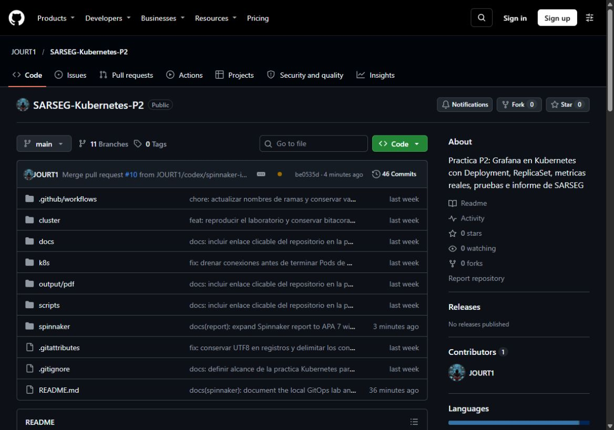

Nota. Captura directa de GitHub. Tomada el 20 de noviembre de 2026. Elaboración propia. Se conserva la imagen completa, sin modificar su contenido. Fuente: https://github.com/JOURT1/SARSEG-Kubernetes-P2

### Paso 2. Organización del trabajo mediante ramas

Se verificó la separación de las ramas de implementación y documentación. Las ramas permiten revisar cambios antes de integrarlos a main (JOURT1, 2026b).

**Figura 2**

*Organización del trabajo mediante ramas*

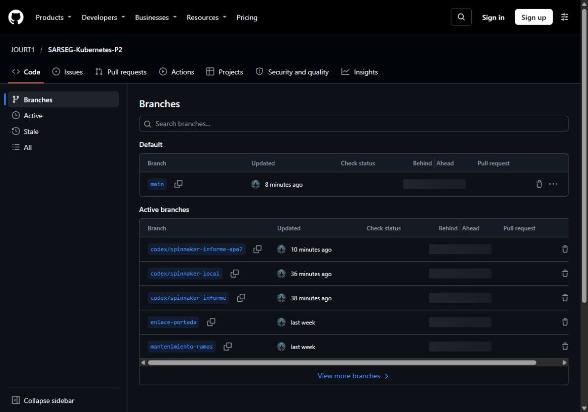

Nota. Captura directa de GitHub. Tomada el 20 de noviembre de 2026. Elaboración propia. Se conserva la imagen completa, sin modificar su contenido. Fuente: https://github.com/JOURT1/SARSEG-Kubernetes-P2/branches

### Paso 3. Historial de commits separados

Se revisó el historial de cambios. La implementación, la demostración automática y la documentación se conservaron como avances independientes (JOURT1, 2026b).

**Figura 3**

*Historial de commits separados*

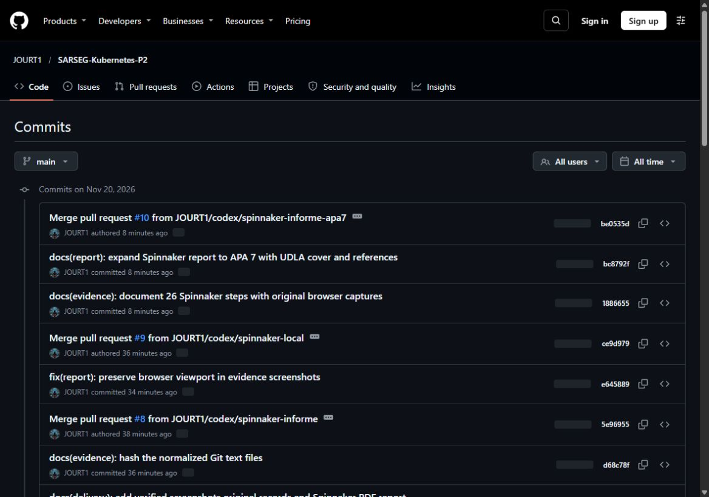

Nota. Captura directa de GitHub. Tomada el 20 de noviembre de 2026. Elaboración propia. Se conserva la imagen completa, sin modificar su contenido. Fuente: https://github.com/JOURT1/SARSEG-Kubernetes-P2/commits/main/

### Paso 4. Pull request de integración de Spinnaker

El pull request 9 documenta la integración de SARSEG con Spinnaker, el seguimiento de Git y la prueba del HPA. Su descripción permite revisar el alcance del laboratorio (JOURT1, 2026b).

**Figura 4**

*Pull request de integración de Spinnaker*

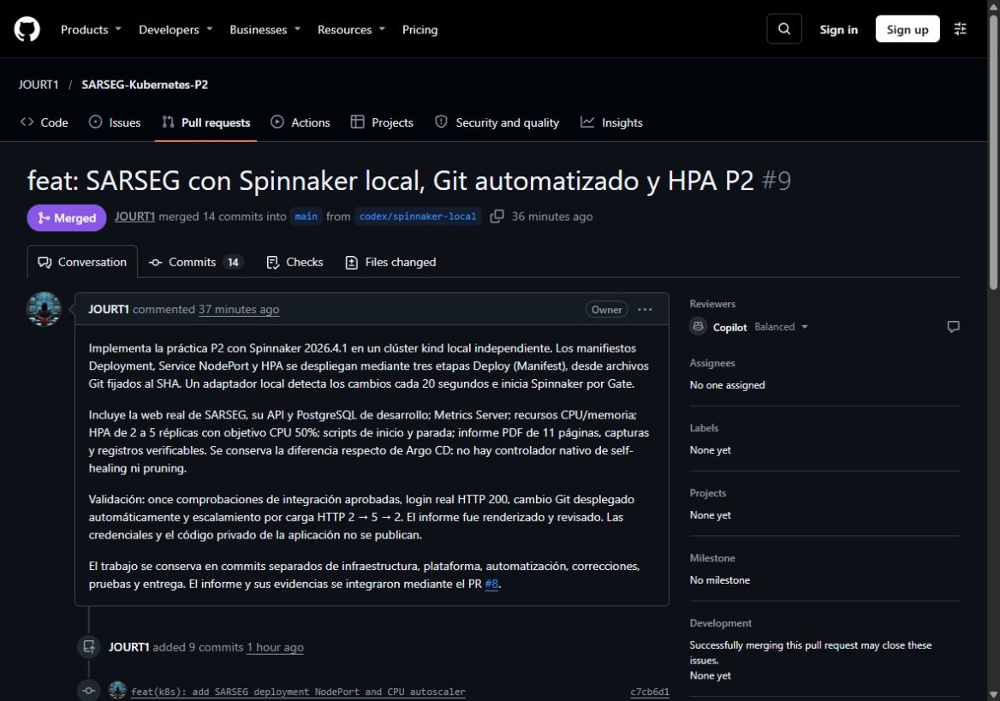

Nota. Captura directa de GitHub. Tomada el 20 de noviembre de 2026. Elaboración propia. Se conserva la imagen completa, sin modificar su contenido. Fuente: https://github.com/JOURT1/SARSEG-Kubernetes-P2/pull/9

### Paso 5. Validación automática en GitHub Actions

Se abrió la ejecución de GitHub Actions correspondiente a la integración. La pantalla presenta la validación satisfactoria; la comprobación local de Kubernetes se documenta en los pasos siguientes (JOURT1, 2026b).

**Figura 5**

*Validación automática en GitHub Actions*

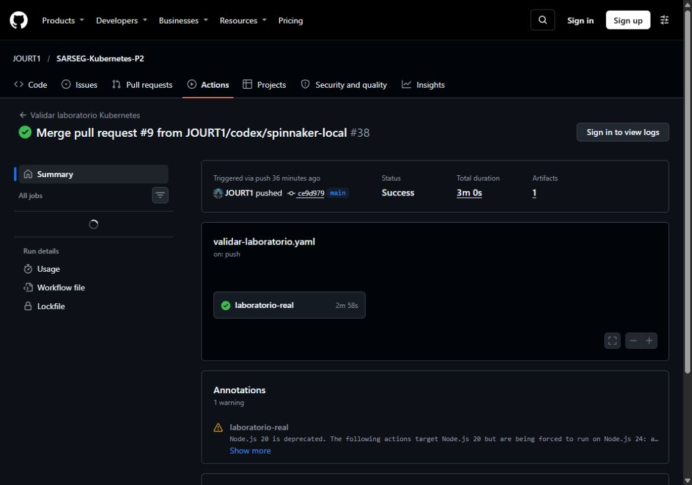

Nota. Captura directa de GitHub. Tomada el 20 de noviembre de 2026. Elaboración propia. Se conserva la imagen completa, sin modificar su contenido. Fuente: https://github.com/JOURT1/SARSEG-Kubernetes-P2/actions/runs/44677978819

### Paso 6. Carpeta con los tres manifiestos Kubernetes

Se comprobó en GitHub la existencia de deployment.yml, service.yml y hpa.yml en la ruta spinnaker/k8s. Los tres archivos se mantienen separados y son los artefactos que consume el pipeline (JOURT1, 2026b).

**Figura 6**

*Carpeta con los tres manifiestos Kubernetes*

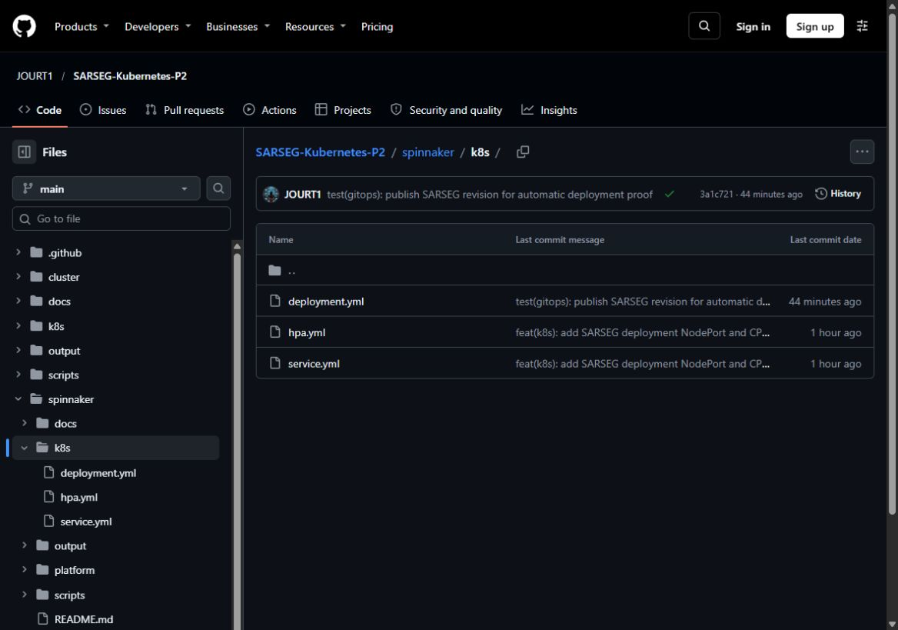

Nota. Captura directa de GitHub. Tomada el 20 de noviembre de 2026. Elaboración propia. Se conserva la imagen completa, sin modificar su contenido. Fuente: https://github.com/JOURT1/SARSEG-Kubernetes-P2/tree/main/spinnaker/k8s

### Paso 7. Clúster local disponible en Headlamp

Se abrió Headlamp conectado al clúster real sarseg-spinnaker. La vista general presenta el nodo disponible, los Pods y las métricas del entorno. Headlamp se usa como visor con permisos de lectura (Headlamp, s. f.).

**Figura 7**

*Clúster local disponible en Headlamp*

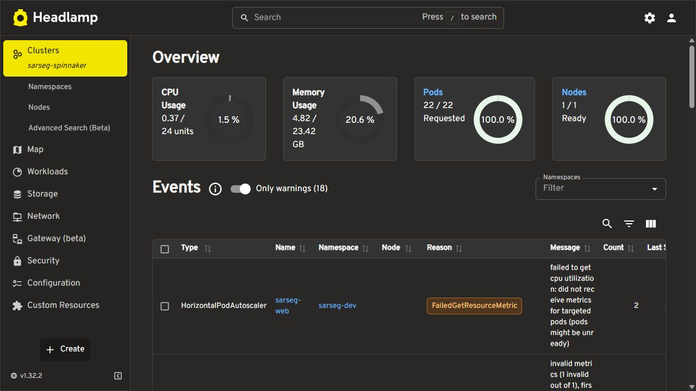

Nota. Captura directa de Headlamp conectado al clúster local. Tomada el 20 de noviembre de 2026. Elaboración propia. Se conserva la imagen completa, sin modificar su contenido. Fuente: http://127.0.0.1:14666/c/sarseg-spinnaker/

### Paso 8. Metrics Server operativo

Se verificó que Metrics Server tuviera una réplica disponible en kube-system. El HPA necesita la API de métricas y los requests de CPU configurados en los contenedores (Kubernetes, s. f.-b; Kubernetes SIGs, s. f.-b).

**Figura 8**

*Metrics Server operativo*

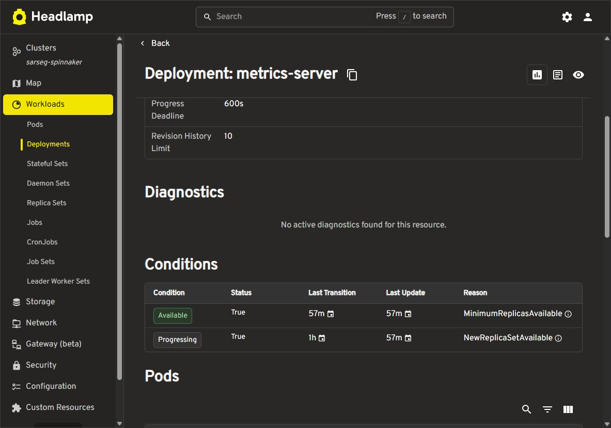

Nota. Captura directa de Headlamp conectado al clúster local. Tomada el 20 de noviembre de 2026. Elaboración propia. Se conserva la imagen completa, sin modificar su contenido. Fuente: http://127.0.0.1:14666/c/sarseg-spinnaker/deployments/kube-system/metrics-server

### Paso 9. Etapa de despliegue del Deployment

Se inspeccionó la primera etapa Deploy (Manifest) del pipeline deploy-git. La cuenta sarseg-local y el namespace sarseg-dev identifican el destino local; el manifiesto se obtiene como artefacto (Spinnaker, s. f.-a, s. f.-b).

**Figura 9**

*Etapa de despliegue del Deployment*

Nota. Captura directa de Spinnaker Deck. Tomada el 20 de noviembre de 2026. Elaboración propia. Se conserva la imagen completa, sin modificar su contenido. Fuente: http://127.0.0.1:14900/#/applications/sarseg/executions/configure/sarseg-deploy-git

### Paso 10. Etapa de despliegue del Service

Se revisó la etapa Deploy service.yml y su dependencia de la etapa anterior. Esta secuencia aplica el Service que selecciona los Pods de la aplicación (Spinnaker, s. f.-b).

**Figura 10**

*Etapa de despliegue del Service*

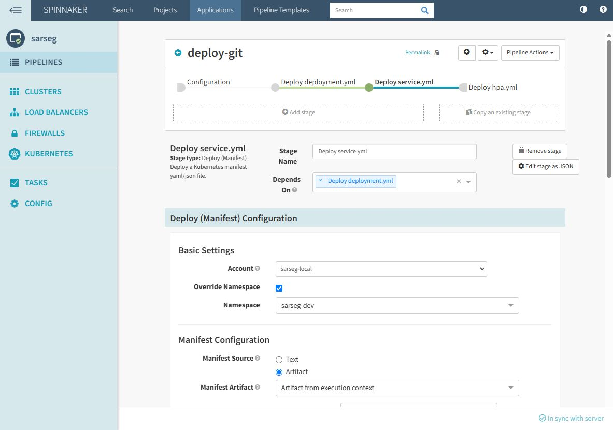

Nota. Captura directa de Spinnaker Deck. Tomada el 20 de noviembre de 2026. Elaboración propia. Se conserva la imagen completa, sin modificar su contenido. Fuente: http://127.0.0.1:14900/#/applications/sarseg/executions/configure/sarseg-deploy-git

### Paso 11. Etapa de despliegue del HPA

Se revisó la tercera etapa, Deploy hpa.yml, dirigida al mismo namespace. Spinnaker aplica el HPA después del Deployment y del Service (Spinnaker, s. f.-b).

**Figura 11**

*Etapa de despliegue del HPA*

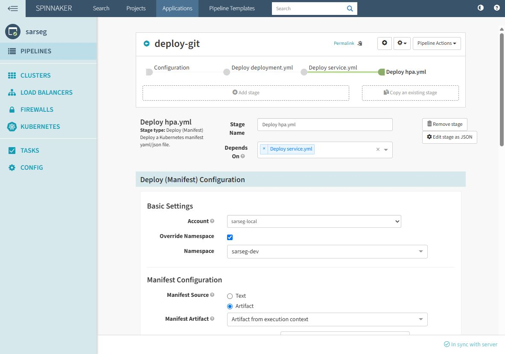

Nota. Captura directa de Spinnaker Deck. Tomada el 20 de noviembre de 2026. Elaboración propia. Se conserva la imagen completa, sin modificar su contenido. Fuente: http://127.0.0.1:14900/#/applications/sarseg/executions/configure/sarseg-deploy-git

### Paso 12. Ejecuciones satisfactorias del pipeline

La pantalla nativa de Deck muestra ejecuciones en SUCCEEDED iniciadas por local-git-poller. El adaptador detecta cambios de los manifiestos y solicita la ejecución a Gate; las tres etapas despliegan los recursos (JOURT1, 2026a).

**Figura 12**

*Ejecuciones satisfactorias del pipeline*

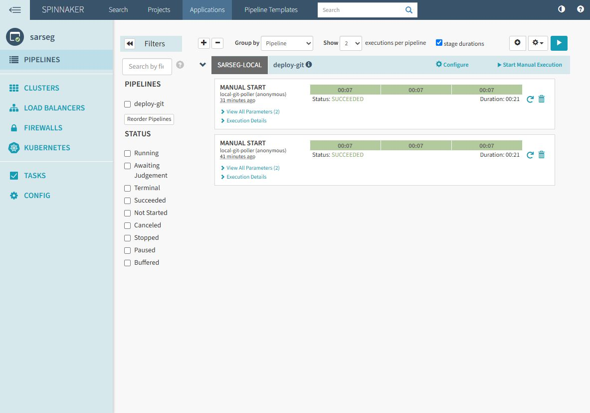

Nota. Captura directa de Spinnaker Deck. Tomada el 20 de noviembre de 2026. Elaboración propia. Se conserva la imagen completa, sin modificar su contenido. Fuente: http://127.0.0.1:14900/#/applications/sarseg/executions

### Paso 13. Revisión Git y etapas de la ejecución

Se expandieron los parámetros y detalles de la ejecución de main. El parámetro gitSha vincula los artefactos a una revisión inmutable del repositorio; las etapas muestran el resultado satisfactorio (JOURT1, 2026a; Spinnaker, s. f.-a).

**Figura 13**

*Revisión Git y etapas de la ejecución*

Nota. Captura directa de Spinnaker Deck. Tomada el 20 de noviembre de 2026. Elaboración propia. Se conserva la imagen completa, sin modificar su contenido. Fuente: http://127.0.0.1:14900/#/applications/sarseg/executions

### Paso 14. Deployment administrado por Spinnaker

Se abrió el detalle del Deployment en Deck. La cuenta, el namespace, las etiquetas y las condiciones de disponibilidad permiten relacionar el recurso desplegado con la aplicación SARSEG (JOURT1, 2026a).

**Figura 14**

*Deployment administrado por Spinnaker*

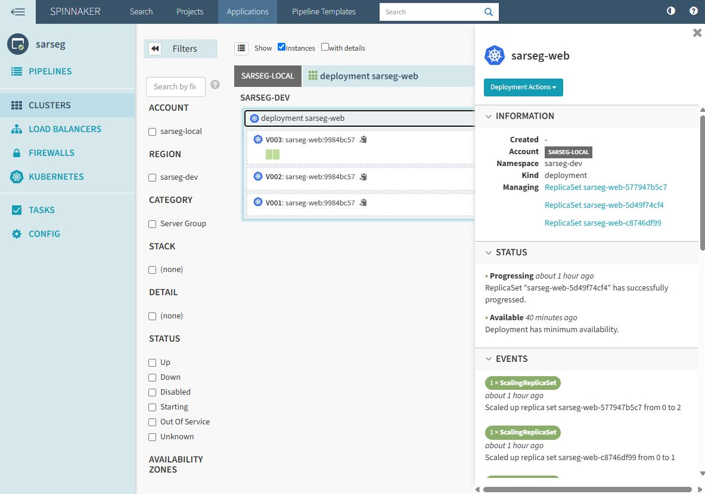

Nota. Captura directa de Spinnaker Deck. Tomada el 20 de noviembre de 2026. Elaboración propia. Se conserva la imagen completa, sin modificar su contenido. Fuente: http://127.0.0.1:14900/#/applications/sarseg/clusters

### Paso 15. Etiquetas y selector del Deployment activo

Se inspeccionó el Deployment directamente en Kubernetes. El selector app: sarseg-web coincide con la etiqueta de sus Pods. La política RollingUpdate permite actualizar la aplicación manteniendo disponibilidad (Kubernetes, s. f.-a).

**Figura 15**

*Etiquetas y selector del Deployment activo*

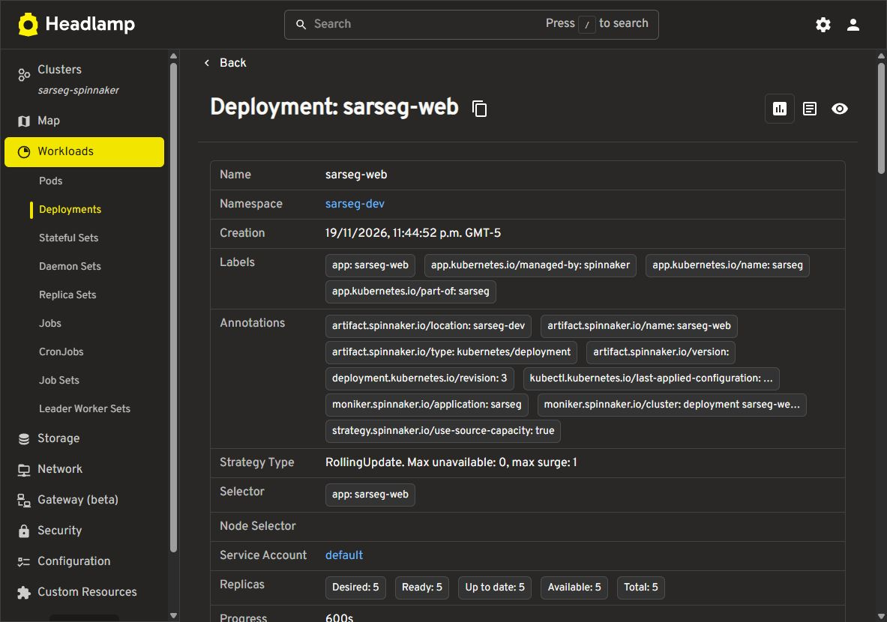

Nota. Captura directa de Headlamp conectado al clúster local. Tomada el 20 de noviembre de 2026. Elaboración propia. Se conserva la imagen completa, sin modificar su contenido. Fuente: http://127.0.0.1:14666/c/sarseg-spinnaker/deployments/sarseg-dev/sarseg-web

### Paso 16. Service NodePort y selección de Pods

La pantalla del Service confirma el tipo NodePort y el selector app: sarseg-web. Esta asociación dirige el tráfico únicamente a los Pods de la aplicación (Kubernetes, s. f.-d).

**Figura 16**

*Service NodePort y selección de Pods*

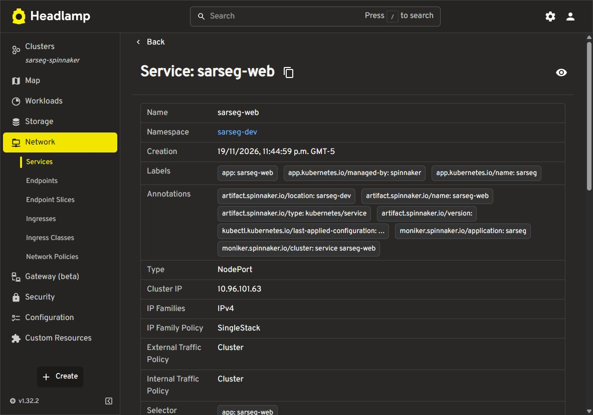

Nota. Captura directa de Headlamp conectado al clúster local. Tomada el 20 de noviembre de 2026. Elaboración propia. Se conserva la imagen completa, sin modificar su contenido. Fuente: http://127.0.0.1:14666/c/sarseg-spinnaker/services/sarseg-dev/sarseg-web

### Paso 17. Puertos y endpoints reales del Service

La sección Ports muestra el puerto 80, el destino con nombre http y el NodePort 30380. Los endpoints resuelven al puerto 8080 de los Pods disponibles (Kubernetes, s. f.-d).

**Figura 17**

*Puertos y endpoints reales del Service*

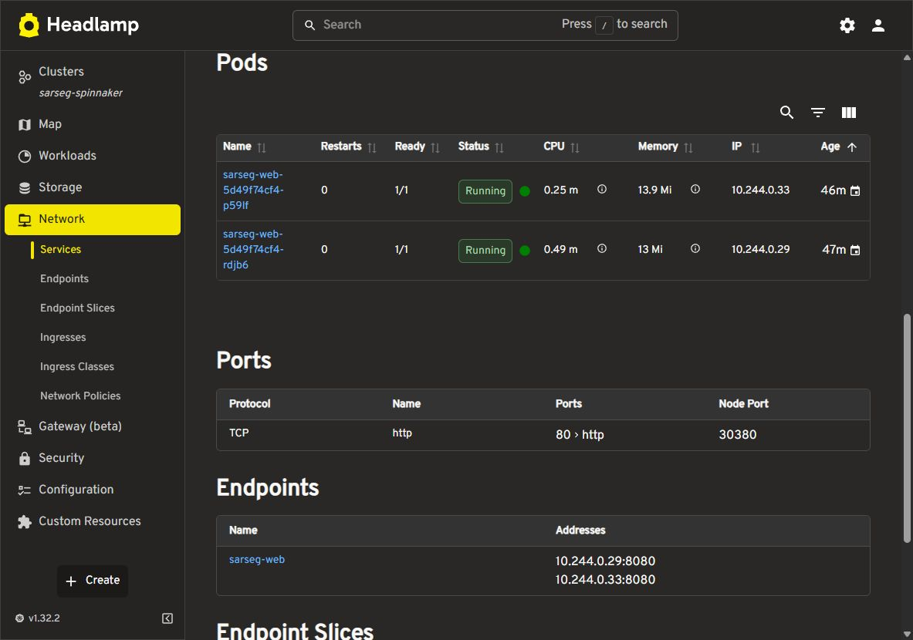

Nota. Captura directa de Headlamp conectado al clúster local. Tomada el 20 de noviembre de 2026. Elaboración propia. Se conserva la imagen completa, sin modificar su contenido. Fuente: http://127.0.0.1:14666/c/sarseg-spinnaker/services/sarseg-dev/sarseg-web

### Paso 18. Aplicación SARSEG accesible en el navegador

Se accedió a la web real de SARSEG desde el puerto local 14800, mapeado al NodePort del clúster kind. La pantalla de inicio de sesión confirma que la aplicación web responde (JOURT1, 2026a; Kubernetes SIGs, s. f.-a).

**Figura 18**

*Aplicación SARSEG accesible en el navegador*

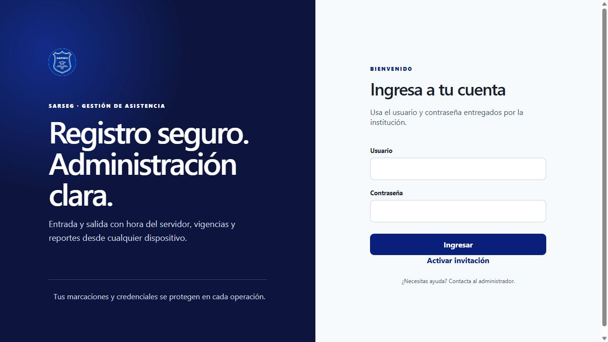

Nota. Captura directa de SARSEG. Tomada el 20 de noviembre de 2026. Elaboración propia. Se conserva la imagen completa, sin modificar su contenido. Fuente: http://127.0.0.1:14800/

### Paso 19. HPA en reposo: dos réplicas y objetivo del 50 %

Antes de generar carga se capturó el HPA con dos réplicas, mínimo dos, máximo cinco y objetivo de utilización de CPU del 50 %. La referencia apunta al Deployment sarseg-web (Kubernetes, s. f.-b).

**Figura 19**

*HPA en reposo: dos réplicas y objetivo del 50 %*

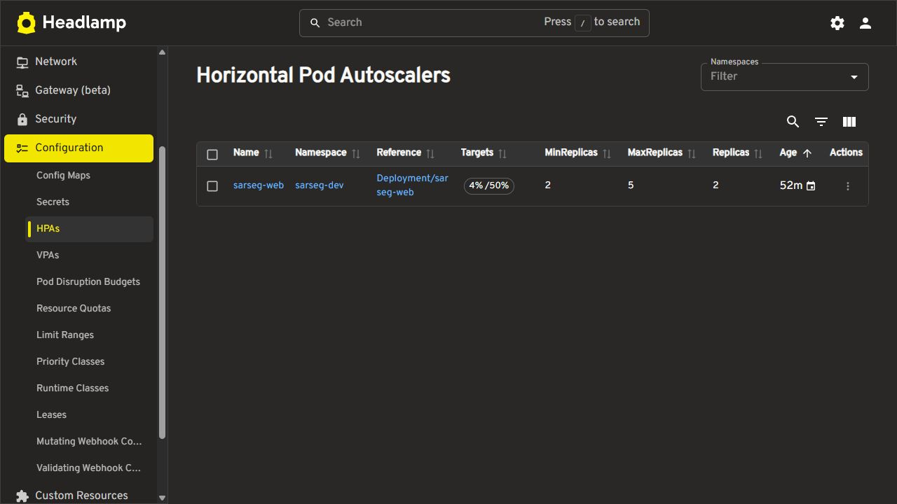

Nota. Captura directa de Headlamp conectado al clúster local. Tomada el 20 de noviembre de 2026. Elaboración propia. Se conserva la imagen completa, sin modificar su contenido. Fuente: http://127.0.0.1:14666/c/sarseg-spinnaker/horizontalpodautoscalers

### Paso 20. Condiciones del HPA y métricas válidas

La vista de detalle presenta AbleToScale y ScalingActive en True. ValidMetricFound indica que el controlador pudo calcular las réplicas a partir de la utilización de CPU; el límite mínimo mantiene dos instancias (Kubernetes, s. f.-b).

**Figura 20**

*Condiciones del HPA y métricas válidas*

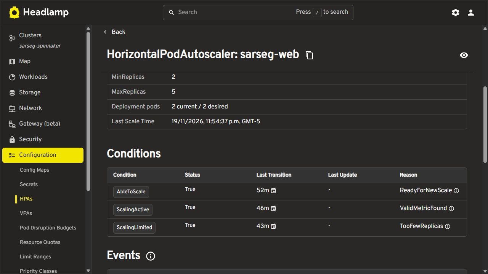

Nota. Captura directa de Headlamp conectado al clúster local. Tomada el 20 de noviembre de 2026. Elaboración propia. Se conserva la imagen completa, sin modificar su contenido. Fuente: http://127.0.0.1:14666/c/sarseg-spinnaker/horizontalpodautoscalers/sarseg-dev/sarseg-web

### Paso 21. Aumento automático a cinco réplicas bajo carga

Se generó tráfico HTTP real mediante un Job temporal. La pantalla del HPA registró 640 % de utilización respecto de los requests, frente al objetivo del 50 %, y cinco réplicas. No se cambió manualmente la capacidad (Kubernetes, s. f.-b, s. f.-c).

**Figura 21**

*Aumento automático a cinco réplicas bajo carga*

Nota. Captura directa de Headlamp conectado al clúster local. Tomada el 20 de noviembre de 2026. Elaboración propia. Se conserva la imagen completa, sin modificar su contenido. Fuente: http://127.0.0.1:14666/c/sarseg-spinnaker/horizontalpodautoscalers

### Paso 22. Deployment con cinco réplicas disponibles

Durante la prueba, el Deployment confirmó cinco réplicas deseadas, listas, actualizadas y disponibles. Esta observación complementa el contador del HPA con el estado real de la carga de trabajo (JOURT1, 2026a).

**Figura 22**

*Deployment con cinco réplicas disponibles*

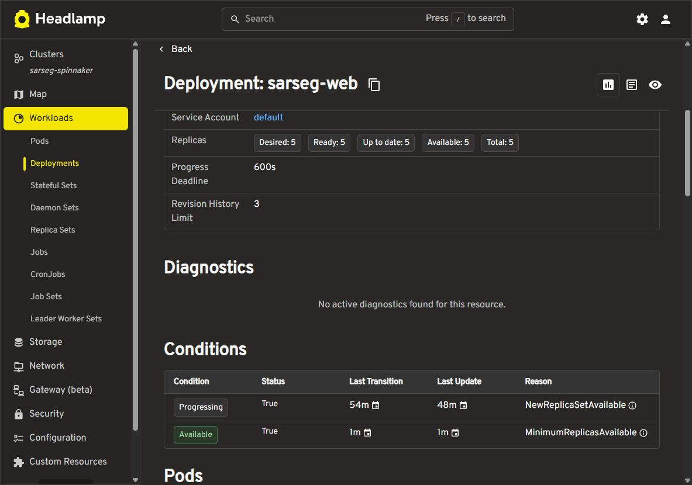

Nota. Captura directa de Headlamp conectado al clúster local. Tomada el 20 de noviembre de 2026. Elaboración propia. Se conserva la imagen completa, sin modificar su contenido. Fuente: http://127.0.0.1:14666/c/sarseg-spinnaker/deployments/sarseg-dev/sarseg-web

### Paso 23. Reducción automática a dos réplicas

Después de retirar el Job de carga, se esperó la actualización de métricas y la ventana de estabilización. El HPA volvió a dos réplicas, respetando el mínimo definido (Kubernetes, s. f.-b).

**Figura 23**

*Reducción automática a dos réplicas*

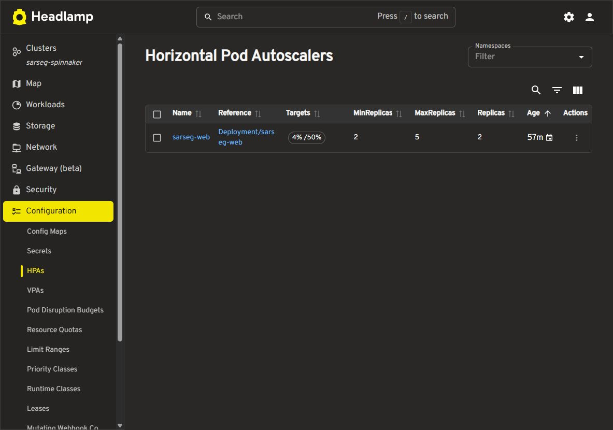

Nota. Captura directa de Headlamp conectado al clúster local. Tomada el 20 de noviembre de 2026. Elaboración propia. Se conserva la imagen completa, sin modificar su contenido. Fuente: http://127.0.0.1:14666/c/sarseg-spinnaker/horizontalpodautoscalers

## Resultados y discusión

Las once comprobaciones finalizaron correctamente. La Tabla 2 vincula cada condición con su resultado; las salidas completas se conservan en results.json y en los estados asociados del repositorio (JOURT1, 2026a).

**Tabla 2. Verificaciones de integración de SARSEG y Spinnaker**

| Comprobación | Resultado |

|---|---|

| Dos Pods iniciales Ready | Aprobado |

| Recursos y selectores coincidentes | Aprobado |

| Service NodePort accesible | Aprobado |

| HPA: mínimo 2, máximo 5 y CPU 50% | Aprobado |

| Web y API disponibles por HTTP | Aprobado |

| Login real HTTP 200 | Aprobado |

| Métricas CPU/memoria disponibles | Aprobado |

| Nuevo SHA desplegado automáticamente | Aprobado |

| Tres etapas de Spinnaker SUCCEEDED | Aprobado |

| Incremento automático de 2 a 5 | Aprobado |

| Reducción automática de 5 a 2 | Aprobado |

El cambio Git verificado fue 3a1c721e4f71729f628d267d52264f96a1944ab5. La ejecución 01M7VMP5J4C39HZM0Y8G8C4GX1 terminó en SUCCEEDED y aplicó la revisión esperada. La evidencia de carga muestra cinco Pods Ready; después de retirarla, Deployment y HPA volvieron a dos.

La captura de esta edición registró 640% de utilización respecto de los requests. Esto no significa exceder el límite de CPU: el porcentaje se calcula sobre la solicitud de 25m por Pod. El objetivo del 50% equivale a 12,5m por Pod, por lo que la carga justificó el escalamiento (Kubernetes, s. f.-b, s. f.-c).

## Incidencias, límites y conclusiones

La primera definición del pipeline no enlazó el artefacto esperado y terminó en TERMINAL. La corrección declaró el artefacto HTTP en la etapa y parametrizó su referencia con gitSha. Las ejecuciones posteriores verificaron los tres manifiestos. También se añadió una espera de PostgreSQL antes de iniciar la API para evitar fallos durante el arranque.

La infraestructura se ejecuta en una computadora, con puertos limitados a loopback y configuración de desarrollo. La web y la API se construyen desde el repositorio privado original, cuyo código y credenciales no se publican. La reproducción completa requiere permiso para obtener ese código o disponer de las imágenes locales compiladas.

Se cumplió el objetivo de desplegar SARSEG automáticamente desde Git con Spinnaker. El Deployment inició con dos réplicas, el Service permitió acceso por NodePort, Metrics Server suministró métricas y el HPA ajustó la capacidad de dos a cinco y nuevamente a dos. La detección Git quedó documentada como adaptación local con diferencias frente a Argo CD.

## Referencias

American Psychological Association. (s. f.-a). <i>Figure setup.</i> https://apastyle.apa.org/style-grammar-guidelines/tables-figures/figures

American Psychological Association. (s. f.-b). <i>Title page setup.</i> https://apastyle.apa.org/style-grammar-guidelines/paper-format/title-page

Docker. (s. f.). <i>Docker Desktop.</i> Docker Docs. https://docs.docker.com/desktop/

Headlamp. (s. f.). <i>In-cluster.</i> https://headlamp.dev/docs/latest/installation/in-cluster/

JOURT1. (2026a). <i>Resultados y evidencias originales del laboratorio SARSEG con Spinnaker</i> [Conjunto de datos]. GitHub. https://github.com/JOURT1/SARSEG-Kubernetes-P2/tree/main/spinnaker/docs/evidencias

JOURT1. (2026b). <i>SARSEG Kubernetes P2: Laboratorio local de configuración continua con Spinnaker</i> [Repositorio de código]. GitHub. https://github.com/JOURT1/SARSEG-Kubernetes-P2/tree/main/spinnaker

Kubernetes. (s. f.-a). <i>Deployments.</i> https://kubernetes.io/docs/concepts/workloads/controllers/deployment/

Kubernetes. (s. f.-b). <i>Horizontal Pod autoscaling.</i> https://kubernetes.io/docs/concepts/workloads/autoscaling/horizontal-pod-autoscale/

Kubernetes. (s. f.-c). <i>Resource management for Pods and containers.</i> https://kubernetes.io/docs/concepts/configuration/manage-resources-containers/

Kubernetes. (s. f.-d). <i>Service.</i> https://kubernetes.io/docs/concepts/services-networking/service/

Kubernetes SIGs. (s. f.-a). <i>Configuration.</i> kind. https://kind.sigs.k8s.io/docs/user/configuration/

Kubernetes SIGs. (s. f.-b). <i>Metrics Server</i> (Versión 0.8.1) [Software]. GitHub. https://github.com/kubernetes-sigs/metrics-server/tree/v0.8.1

Spinnaker. (2026). <i>Spinnaker Kustomize</i> (Versión 2026.4.1) [Software]. GitHub. https://github.com/spinnaker/spinnaker/tree/1b3ed435fe5341b41dcbbdce999cb771145166a8/spinnaker-kustomize

Spinnaker. (s. f.-a). <i>HTTP file.</i> https://spinnaker.io/docs/reference/artifacts/types/http-file/

Spinnaker. (s. f.-b). <i>Kubernetes provider overview.</i> https://spinnaker.io/docs/reference/providers/kubernetes/

Universidad de Las Américas. (s. f.). <i>Marca UDLA.</i> https://www.udla.edu.ec/la-udla/marca-udla/

## Trazabilidad de la entrega

El repositorio público reúne los tres manifiestos Kubernetes, el pipeline de Spinnaker, la configuración del laboratorio y este informe. La carpeta capturas-reales conserva las imágenes originales y un índice con fuente, fecha y huella de integridad. Los archivos de registros de las pruebas iniciales permanecen disponibles como material de respaldo, fuera de las figuras de esta edición.

Headlamp se añadió únicamente para observar los recursos mediante una interfaz Kubernetes real. Usa una cuenta de servicio con permisos de lectura y un puerto limitado a la computadora local. No sustituye a Spinnaker: el pipeline continúa siendo el responsable de aplicar los manifiestos (Headlamp, s. f.; JOURT1, 2026b).

Las credenciales y el código privado de la aplicación no forman parte de la entrega pública. La reproducción completa requiere acceso autorizado al repositorio original de SARSEG o a las imágenes compiladas. La implementación se conserva en ramas y commits separados.
