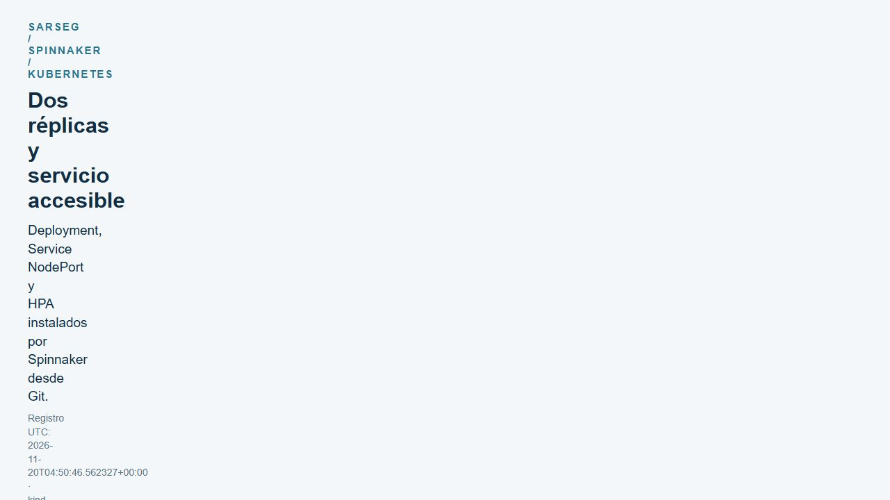
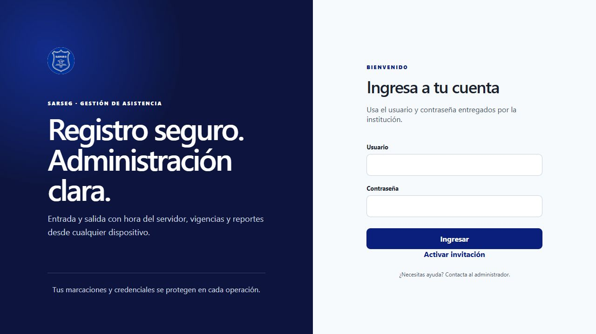
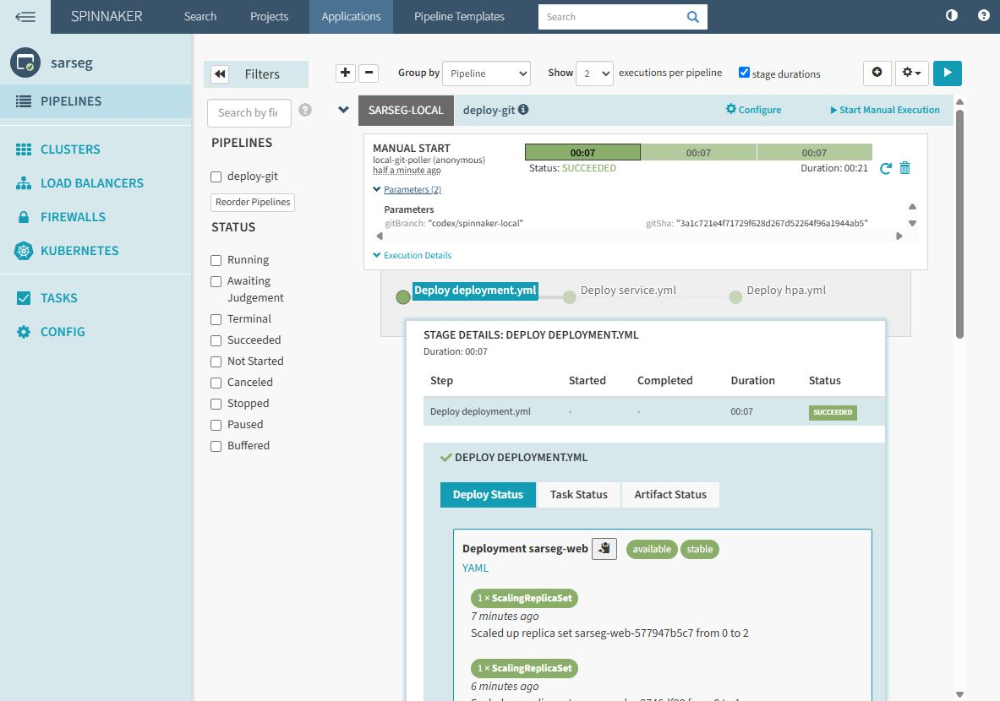
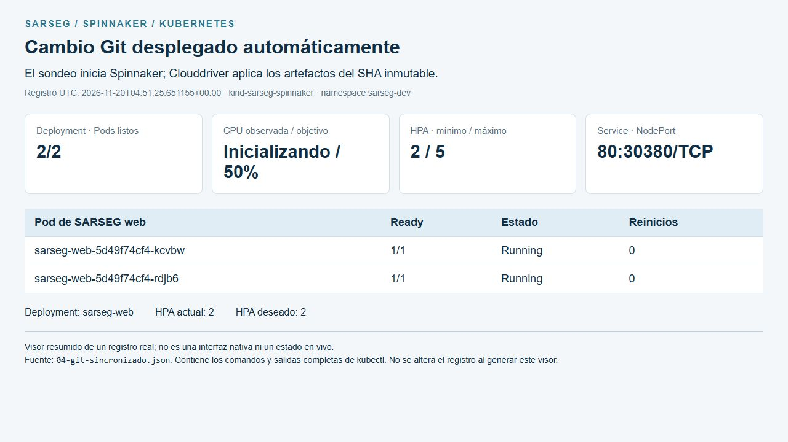
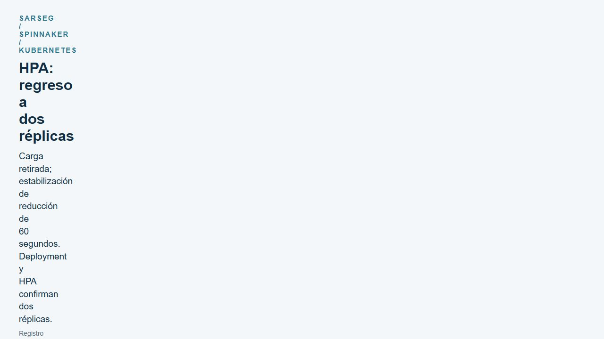

# Informe: configuración continua de SARSEG con Spinnaker

**Práctica P2 (10%) · Jhoel Suárez · 19 de noviembre de 2026**

## Entregables

- [Repositorio público](https://github.com/JOURT1/SARSEG-Kubernetes-P2).
- [Informe PDF](../output/pdf/Informe-SARSEG-Spinnaker-P2.pdf).
- [Deployment](../k8s/deployment.yml), [Service](../k8s/service.yml), [HPA](../k8s/hpa.yml).
- [Pipeline exportado](../pipeline.json).
- [Resultados completos](evidencias/results.json) y [ejecución real de Gate](evidencias/git-execution.json).

## Objetivo y adaptación

Desplegar la web real de SARSEG en Kubernetes desde Git. Por solicitud de la actividad se utiliza Spinnaker en lugar de Argo CD. Un sondeo local cada 20 segundos detecta cambios en los tres manifiestos y dispara el pipeline por Gate. Las tres etapas Deploy (Manifest) descargan y aplican los archivos desde una URL fijada al SHA completo de Git. El adaptador no usa kubectl, no dispone de kubeconfig ni despliega recursos.

Spinnaker no tiene el controlador Automated Sync de Argo CD. Esta entrega implementa despliegue automático de cambios Git con sondeo local y pipeline; no ofrece corrección periódica de desvíos manuales ni borrado automático de recursos eliminados en Git. El HPA controla la cantidad de réplicas después del primer despliegue. La anotación use-source-capacity evita que Spinnaker fuerce dos durante la carga.

## Recursos de la consigna

| Requisito | Configuración |
|---|---|
| Deployment | sarseg-web, namespace sarseg-dev, 2 réplicas iniciales |
| Etiquetas | app=sarseg-web en selector, plantilla de Pods y Service |
| Imagen y puerto | sarseg-web:9984bc57, puerto http=8080 |
| Requests | CPU 25m y memoria 32Mi por Pod web |
| Limits | CPU 250m y memoria 128Mi por Pod web |
| Service | NodePort 30380, port 80, targetPort http (8080) |
| HPA | autoscaling/v2, mínimo 2, máximo 5, CPU 50% |
| Metrics Server | v0.8.1 con API de métricas comprobada |
| Exposición | localhost:14800, únicamente loopback |

La plataforma de apoyo usa Spinnaker 2026.4.1 (Deck, Gate, Orca, Clouddriver y Front50), Redis y MySQL. La API ASP.NET Core y PostgreSQL de prueba permiten verificar la web completa. Las imágenes SARSEG se construyeron desde el commit 9984bc57f1e7252793f146a40542a60940b16463 del repositorio privado original. El código privado no se publica en esta entrega.

## Evidencias de ejecución

1. Estado inicial: dos Pods listos, NodePort y HPA. [Registro original](evidencias/01-inicial.json).

2. Web SARSEG accesible. Se verificaron HTTP 200, /health/ready y login administrativo HTTP 200. Se excluyen contraseñas y respuestas de autenticación de los registros.

3. Pipeline real de Spinnaker: tres etapas SUCCEEDED.

4. Cambio Git publicado y desplegado automáticamente.

Commit: `3a1c721e4f71729f628d267d52264f96a1944ab5`. Rama: `codex/spinnaker-local`. Ejecución: `/pipelines/01M7VMP5J4C39HZM0Y8G8C4GX1`. La prueba comprueba tanto el SHA confirmado como la anotación sarseg.edu/revision ejecutada.

5. Carga HTTP real mediante Job temporal: aumento automático de 2 a 5 Pods listos, sin kubectl scale. [Serie de muestras](evidencias/hpa-up.json).

6. Tras retirar la carga, retorno automático a 2 Pods listos. La ventana de estabilización configurada es de 60 segundos; la reducción no es instantánea. [Serie de muestras](evidencias/hpa-down.json).

Las capturas de estados Kubernetes muestran un visor de salidas originales, identificado expresamente como registro, con comandos y fecha UTC. La fecha local de la ejecución es 19 de noviembre de 2026 (America/Guayaquil). Los archivos JSON/TXT permiten revisar los datos sin depender de las imágenes.

## Verificación y reproducción

El protocolo comprueba once condiciones: dos Pods iniciales listos; recursos/selectores; NodePort; configuración del HPA; web y API accesibles; login real; Metrics Server; despliegue automático del SHA nuevo; tres etapas de Spinnaker correctas; aumento a cinco; reducción a dos.

Se inicia con `spinnaker/scripts/Start-Lab.ps1`. El sondeo sigue main por defecto; para reproducir la prueba con commits en una rama se usa `-Branch <rama>` y luego `python spinnaker/scripts/verify_lab.py --publish-change`. El comando publica un commit real. Se necesita permiso de lectura del repositorio privado SARSEG para reconstruir sus imágenes. La guía detallada está en [README](../README.md).

Los secretos se generan aleatoriamente en `.local/spinnaker/`, fuera de Git. Los permisos de escritura de Clouddriver se limitan a sarseg-dev. La interfaz local de Spinnaker no usa autenticación y los puertos se limitan a 127.0.0.1. No se crean cuentas cloud, recursos de producción ni servicios facturables.

## Incidencias resueltas

La primera configuración no enlazó correctamente los artefactos esperados. Se corrigió usando el artefacto HTTP declarado en cada etapa con el parámetro gitSha, y se verificaron nuevas ejecuciones exitosas. Se añadió espera de PostgreSQL antes de iniciar la API. Los servicios Java se reiniciaron durante la primera preparación de MySQL y después quedaron disponibles. La entrega conserva evidencias de ejecuciones correctas posteriores.

## Referencias

- [Instalador mínimo oficial y licencia](https://github.com/spinnaker/spinnaker/tree/1b3ed435fe5341b41dcbbdce999cb771145166a8/spinnaker-kustomize).
- [Spinnaker: artefactos HTTP](https://spinnaker.io/docs/reference/artifacts/types/http-file/).
- [Spinnaker: proveedor Kubernetes y conservación de capacidad](https://spinnaker.io/docs/reference/providers/kubernetes/).
- [Kubernetes: HPA](https://kubernetes.io/docs/tasks/run-application/horizontal-pod-autoscale/).
- [Metrics Server v0.8.1](https://github.com/kubernetes-sigs/metrics-server/tree/v0.8.1).
