# Automatización de la configuración continua de SARSEG mediante Spinnaker y Kubernetes


Joel Suárez


Universidad de Las Américas · Ingeniería de Software


Asignatura: Procesos de Software


Docente: Mónica Fernanda Sanchez Rosero


20 de noviembre de 2026


## Automatización de la configuración continua de SARSEG mediante Spinnaker y Kubernetes


El presente informe documenta el despliegue automatizado de SARSEG en Kubernetes mediante Spinnaker. Se adapta la consigna de Argo CD a la herramienta solicitada, conservando Git como fuente de los manifiestos Deployment, Service NodePort y Horizontal Pod Autoscaler. La implementación incluye web Ionic/Angular, API ASP.NET Core y PostgreSQL de prueba (JOURT1, 2026b).

La evidencia comprende preparación, configuración, registro de la aplicación, ejecución del pipeline, publicación de un cambio Git y escalamiento por consumo real de CPU. Los resultados originales conservan once comprobaciones aprobadas y la secuencia de réplicas 2 a 5 y de regreso a 2 (JOURT1, 2026a).

Implementar y verificar el despliegue automatizado de SARSEG desde Git mediante Spinnaker, usando recursos Kubernetes declarativos y escalamiento horizontal basado en CPU.

Configurar dos réplicas iniciales con recursos de CPU y memoria; exponer la aplicación por NodePort; habilitar Metrics Server y un HPA entre dos y cinco réplicas al 50% de CPU; comprobar el despliegue de un cambio Git y documentar cada paso con capturas y referencias.


## Fundamento técnico y adaptación de la consigna


Un Deployment declara la plantilla y las réplicas de los Pods y administra sus revisiones (Kubernetes, s. f.-a). Un Service proporciona acceso estable a los Pods seleccionados; aquí se utiliza NodePort (Kubernetes, s. f.-d). El HPA ajusta las réplicas según métricas y calcula la utilización de CPU respecto de los requests configurados (Kubernetes, s. f.-b, s. f.-c).

Spinnaker ejecuta el despliegue mediante un pipeline y su integración Kubernetes. Las etapas Deploy (Manifest) recuperan los archivos como artefactos HTTP. La referencia de cada archivo incorpora un SHA completo para que toda la ejecución use la misma revisión de Git (Spinnaker, s. f.-a, s. f.-b).

Spinnaker no incorpora el mismo controlador Automated Sync de Argo CD. Se implementó un adaptador que consulta Git cada 20 segundos y solicita a Gate una ejecución cuando cambian los manifiestos. No ejecuta kubectl ni aplica recursos: el despliegue corresponde a Orca y Clouddriver. No se implementan corrección periódica de cambios manuales ni eliminación automática de recursos retirados de Git (JOURT1, 2026b).

La anotación strategy.spinnaker.io/use-source-capacity conserva las réplicas existentes en despliegues posteriores. Así, Spinnaker no restablece dos instancias mientras el HPA administra la capacidad bajo carga (Spinnaker, s. f.-b).


## Método de implementación y documentación


Se utilizó un clúster kind independiente dentro de Docker Desktop, sin crear servicios de nube. La plataforma mínima se basó en el instalador oficial de Spinnaker 2026.4.1. La Tabla 1 resume la configuración (Docker, s. f.; Kubernetes SIGs, s. f.-a; Spinnaker, 2026).


**Tabla 1. Componentes y parámetros del laboratorio**


| Componente | Configuración |

|---|---|

| Clúster | sarseg-spinnaker; Kubernetes v1.32.2; kind v0.27.0 |

| Spinnaker | 2026.4.1; Deck, Gate, Orca, Clouddriver y Front50 |

| Apoyo | MySQL, Redis, API SARSEG y PostgreSQL de prueba |

| Deployment web | Dos réplicas iniciales; puerto http/8080 |

| Requests / limits | CPU 25m / 250m; memoria 32Mi / 128Mi |

| Service | NodePort 30380; port 80; targetPort http |

| HPA | Mínimo 2; máximo 5; CPU 50%; reducción estable 60 s |

| Acceso local | SARSEG 14800; Gate 14884; Deck 14900 |

Las pruebas funcionales se realizaron entre el 19 y el 20 de noviembre de 2026. La ampliación documental se tomó el día 20. Cada figura distingue lecturas actuales, archivos versionados, interfaces nativas y registros históricos. Se preservan los JSON originales, las capturas y su índice de integridad.

Se adopta carátula estudiantil, márgenes de 2,54 cm, Times New Roman de 12 puntos, interlineado doble, paginación superior y referencias con sangría francesa. Las figuras tienen número, título en cursiva y nota de fuente (American Psychological Association, s. f.-a, s. f.-b). El logotipo oficial es una adaptación institucional solicitada (Universidad de Las Américas, s. f.).


### Paso 1. Repositorio y organización del trabajo


Se identificó el repositorio público y se separó el trabajo en ramas de implementación y documentación. Los commits y pull requests permiten revisar cada avance sin concentrar toda la entrega en un único cambio (JOURT1, 2026b) (Figura 1).


**Figura 1**

*Repositorio y organización del trabajo*


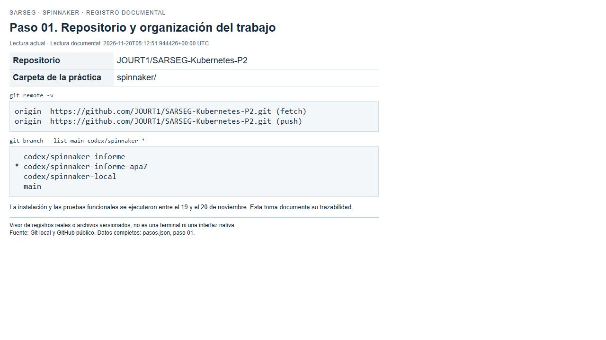


Nota. Elaboración propia: visor documental de lectura actual. Fuente completa: recorrido-apa7/pasos.json, paso 01.


### Paso 2. Docker y herramientas disponibles


Se verificaron Docker Engine, los recursos disponibles, kind y kubectl antes de utilizar el clúster. Docker Desktop proporciona el entorno local para ejecutar contenedores y herramientas de desarrollo (Docker, s. f.) (Figura 2).


**Figura 2**

*Docker y herramientas disponibles*


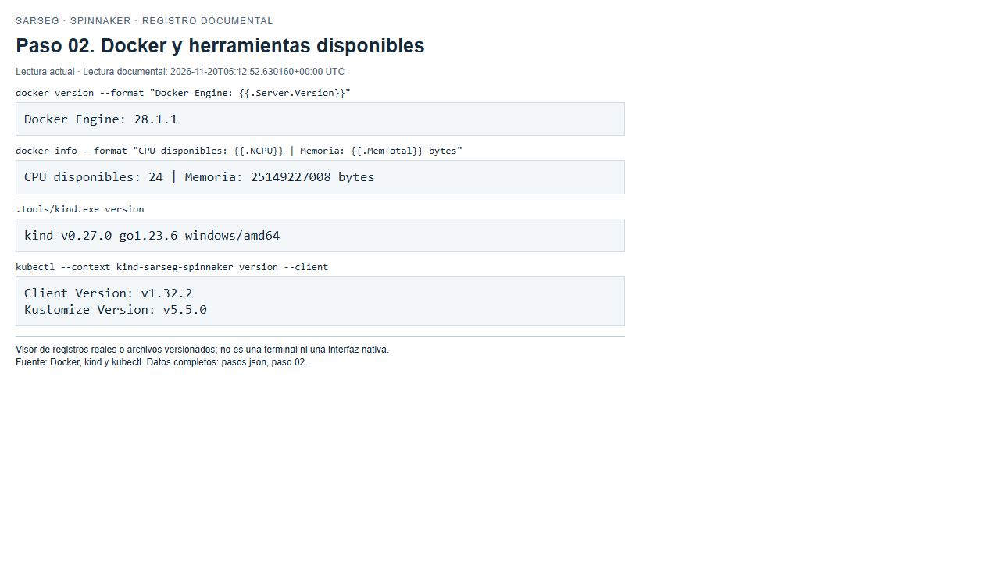


Nota. Elaboración propia: visor documental de lectura actual. Fuente completa: recorrido-apa7/pasos.json, paso 02.


### Paso 3. Configuración del clúster local


Se creó el clúster independiente con kind create cluster --config spinnaker/cluster.yml --wait 180s. El archivo fija Kubernetes v1.32.2 y publica SARSEG, Gate y Deck exclusivamente en 127.0.0.1 (Kubernetes SIGs, s. f.-a) (Figura 3).


**Figura 3**

*Configuración del clúster local*


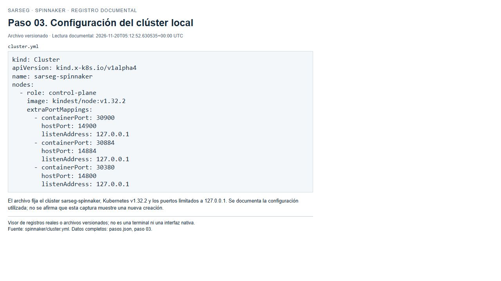


Nota. Elaboración propia: visor documental de archivo versionado. Fuente completa: recorrido-apa7/pasos.json, paso 03.


### Paso 4. Verificación del nodo y del contenedor


Se comprobó que el nodo estuviera Ready y que el contenedor del clúster siguiera activo. Esta lectura verifica la disponibilidad del entorno ya creado antes de interpretar los estados de la aplicación (Kubernetes SIGs, s. f.-a) (Figura 4).


**Figura 4**

*Verificación del nodo y del contenedor*


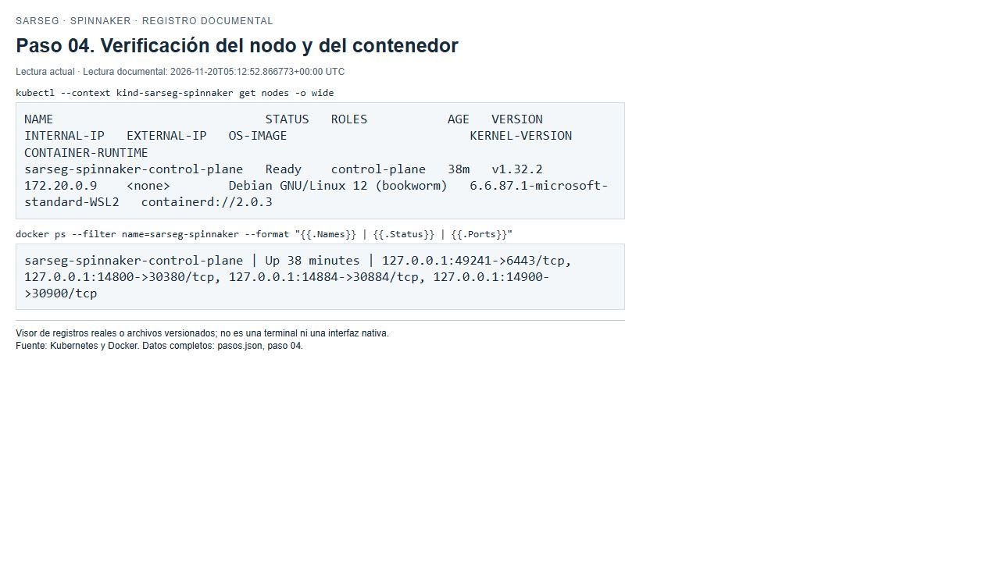


Nota. Elaboración propia: visor documental de lectura actual. Fuente completa: recorrido-apa7/pasos.json, paso 04.


### Paso 5. Imágenes reales de SARSEG construidas


Se compilaron web y API con deploy/web.Dockerfile y deploy/api.Dockerfile y se cargaron mediante kind load docker-image. La captura inspecciona sus identificadores y commit de origen, sin publicar el código privado (JOURT1, 2026b) (Figura 5).


**Figura 5**

*Imágenes reales de SARSEG construidas*


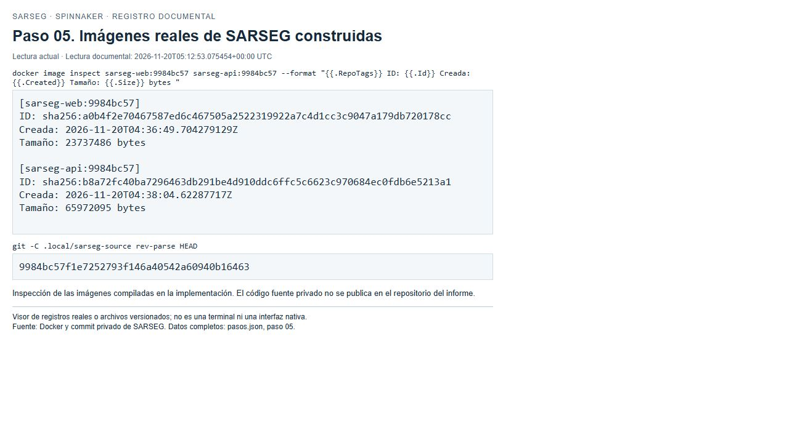


Nota. Elaboración propia: visor documental de lectura actual. Fuente completa: recorrido-apa7/pasos.json, paso 05.


### Paso 6. Namespaces, secretos locales y permisos


Se prepararon namespaces independientes y secretos locales excluidos de Git. La cuenta de Clouddriver puede crear Deployments en sarseg-dev y no en default; la comprobación muestra la limitación de sus permisos (JOURT1, 2026b) (Figura 6).


**Figura 6**

*Namespaces, secretos locales y permisos*


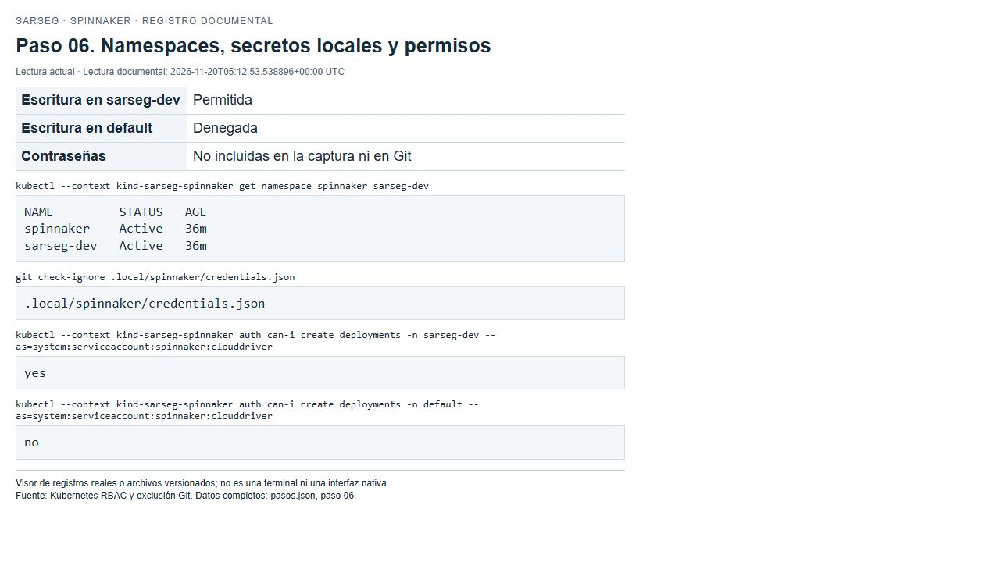


Nota. Elaboración propia: visor documental de lectura actual. Fuente completa: recorrido-apa7/pasos.json, paso 06.


### Paso 7. Plataforma mínima de Spinnaker disponible


Se instaló la plataforma mediante scripts/bootstrap.py y se verificaron Deck, Gate, Orca, Clouddriver y Front50, con MySQL y Redis. La configuración parte del instalador oficial y omite componentes innecesarios para esta práctica (Spinnaker, 2026) (Figura 7).


**Figura 7**

*Plataforma mínima de Spinnaker disponible*


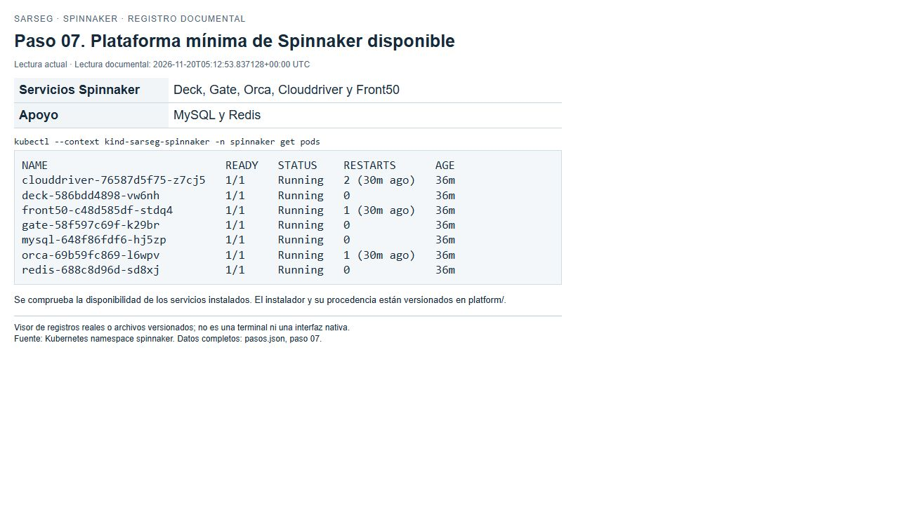


Nota. Elaboración propia: visor documental de lectura actual. Fuente completa: recorrido-apa7/pasos.json, paso 07.


### Paso 8. Metrics Server y mediciones de CPU


Se comprobó que metrics.k8s.io entregara consumo de CPU y memoria de los Pods web. El HPA necesita estas métricas y solicitudes de CPU definidas para calcular utilización (Kubernetes SIGs, s. f.-b) (Figura 8).


**Figura 8**

*Metrics Server y mediciones de CPU*


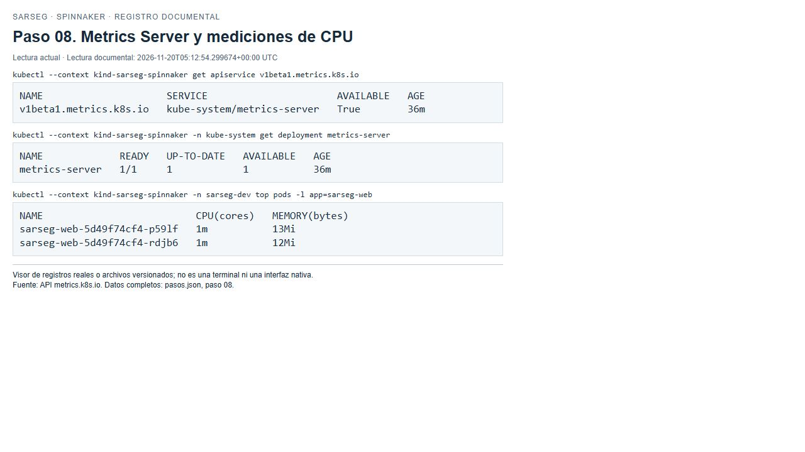


Nota. Elaboración propia: visor documental de lectura actual. Fuente completa: recorrido-apa7/pasos.json, paso 08.


### Paso 9. Deployment: réplicas, etiquetas y selector


Se configuraron dos réplicas iniciales y un selector app=sarseg-web coincidente con las etiquetas de la plantilla de Pods. El Deployment administra las revisiones y la cantidad deseada de instancias (Kubernetes, s. f.-a) (Figura 9).


**Figura 9**

*Deployment: réplicas, etiquetas y selector*


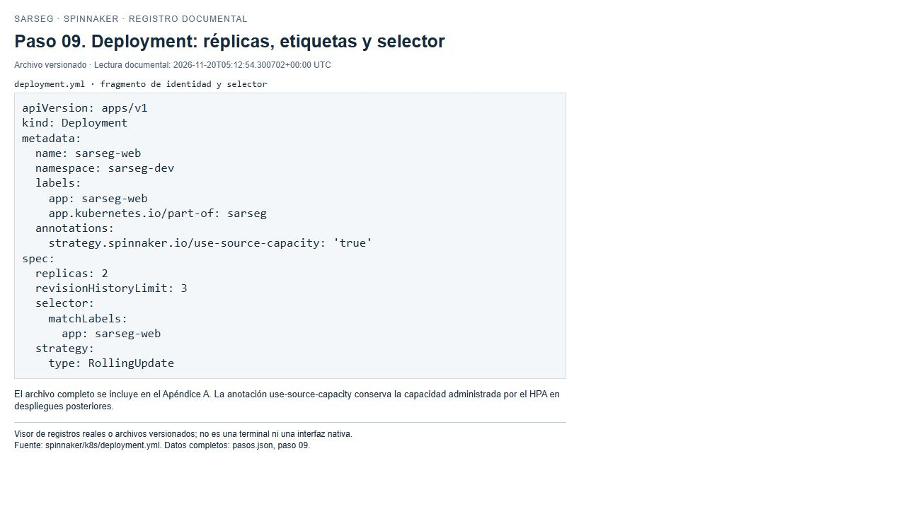


Nota. Elaboración propia: visor documental de archivo versionado. Fuente completa: recorrido-apa7/pasos.json, paso 09.


### Paso 10. Deployment: puerto y recursos por Pod


Se expuso el puerto 8080 con el nombre http y se definieron requests, limits y probes HTTP. Las solicitudes de CPU son la referencia para la métrica porcentual del HPA (Kubernetes, s. f.-c) (Figura 10).


**Figura 10**

*Deployment: puerto y recursos por Pod*


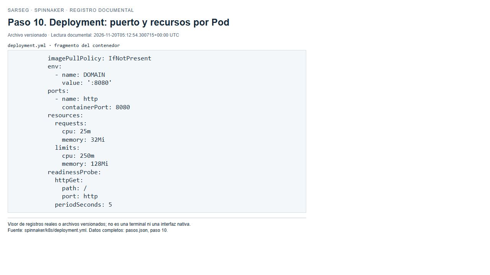


Nota. Elaboración propia: visor documental de archivo versionado. Fuente completa: recorrido-apa7/pasos.json, paso 10.


### Paso 11. Service: exposición mediante NodePort


Se creó un Service NodePort con puerto 80, targetPort http y NodePort 30380. Su selector dirige el tráfico a los Pods web y kind lo expone en el puerto local 14800 (Kubernetes, s. f.-d) (Figura 11).


**Figura 11**

*Service: exposición mediante NodePort*


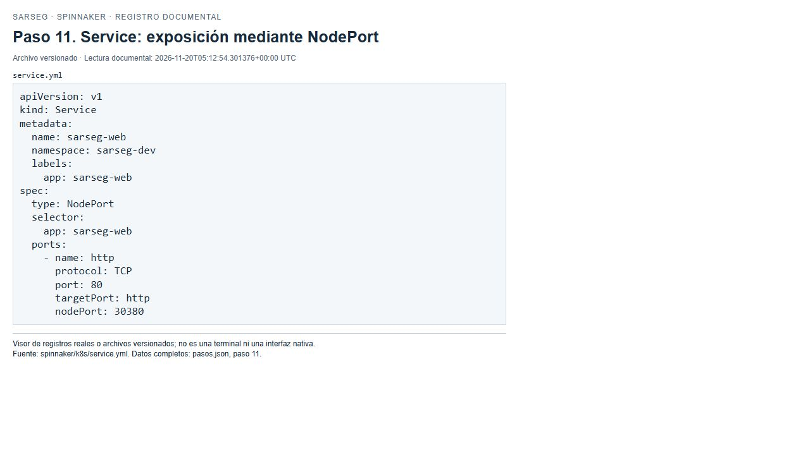


Nota. Elaboración propia: visor documental de archivo versionado. Fuente completa: recorrido-apa7/pasos.json, paso 11.


### Paso 12. HPA: política de escalamiento por CPU


Se configuró el HPA para sarseg-web con mínimo dos, máximo cinco y CPU objetivo del 50%. La reducción usa una ventana de estabilización de 60 segundos para evitar ajustes ante variaciones breves (Kubernetes, s. f.-b) (Figura 12).


**Figura 12**

*HPA: política de escalamiento por CPU*


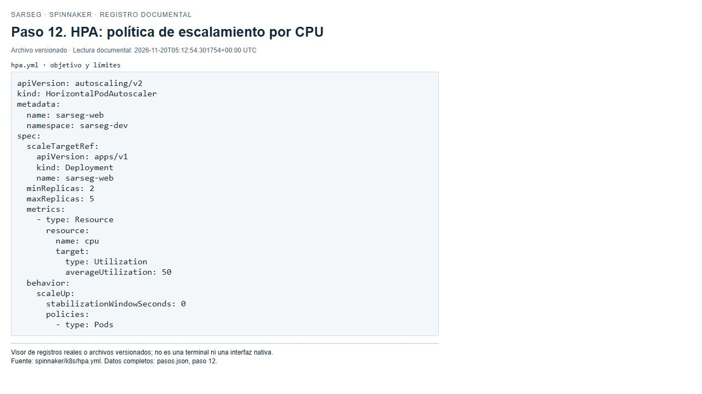


Nota. Elaboración propia: visor documental de archivo versionado. Fuente completa: recorrido-apa7/pasos.json, paso 12.


### Paso 13. Aplicación y cuenta Kubernetes en Spinnaker


Se registró la aplicación sarseg y la cuenta Kubernetes sarseg-local, limitada a sarseg-dev. La cuenta public-git-http permite recuperar los manifiestos del repositorio público durante el despliegue (Spinnaker, s. f.-a, s. f.-b) (Figura 13).


**Figura 13**

*Aplicación y cuenta Kubernetes en Spinnaker*


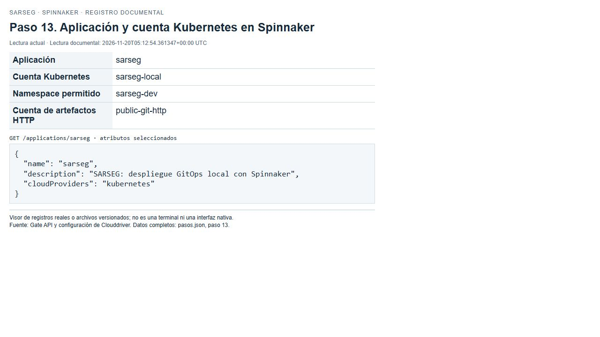


Nota. Elaboración propia: visor documental de lectura actual. Fuente completa: recorrido-apa7/pasos.json, paso 13.


### Paso 14. Pipeline: tres etapas Deploy (Manifest)


Se definieron tres etapas Deploy (Manifest), una por cada YAML. Las referencias HTTP incorporan parameters.gitSha, por lo que todos los archivos de una ejecución proceden del mismo commit inmutable (Spinnaker, s. f.-a) (Figura 14).


**Figura 14**

*Pipeline: tres etapas Deploy (Manifest)*


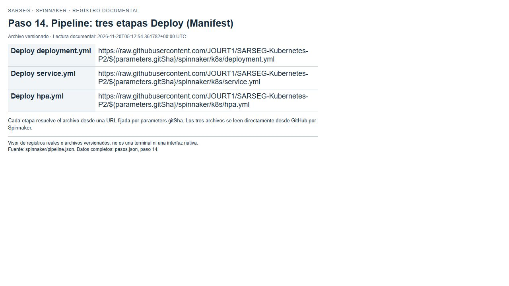


Nota. Elaboración propia: visor documental de archivo versionado. Fuente completa: recorrido-apa7/pasos.json, paso 14.


### Paso 15. Sondeo Git y disparo automático del pipeline


Se implementó un sondeo cada 20 segundos. Cuando cambia el contenido de los manifiestos, solicita a Gate una ejecución y confirma la revisión únicamente al recibir SUCCEEDED. El adaptador no aplica recursos directamente (JOURT1, 2026b) (Figura 15).


**Figura 15**

*Sondeo Git y disparo automático del pipeline*


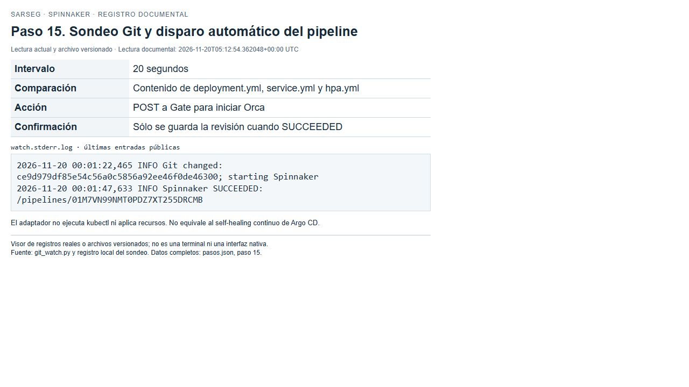


Nota. Elaboración propia: visor documental de lectura actual y archivo versionado. Fuente completa: recorrido-apa7/pasos.json, paso 15.


### Paso 16. Incidencia inicial y corrección de artefactos


La primera configuración de artefactos produjo una ejecución TERMINAL. Se corrigió declarando el artefacto HTTP en cada etapa y resolviendo su referencia con gitSha. Las ejecuciones posteriores verificaron la corrección (JOURT1, 2026a) (Figura 16).


**Figura 16**

*Incidencia inicial y corrección de artefactos*


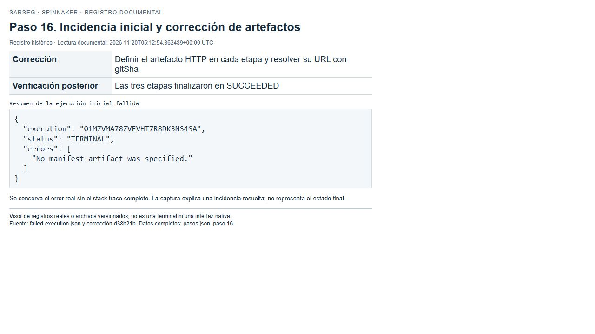


Nota. Elaboración propia: visor documental de registro histórico. Fuente completa: recorrido-apa7/pasos.json, paso 16.


### Paso 17. Primer despliegue completo desde Git


Se ejecutó el primer despliegue completo desde Git. Gate conserva SUCCEEDED en las etapas Deployment, Service y HPA, además de los parámetros y referencias utilizados por Spinnaker (JOURT1, 2026a) (Figura 17).


**Figura 17**

*Primer despliegue completo desde Git*


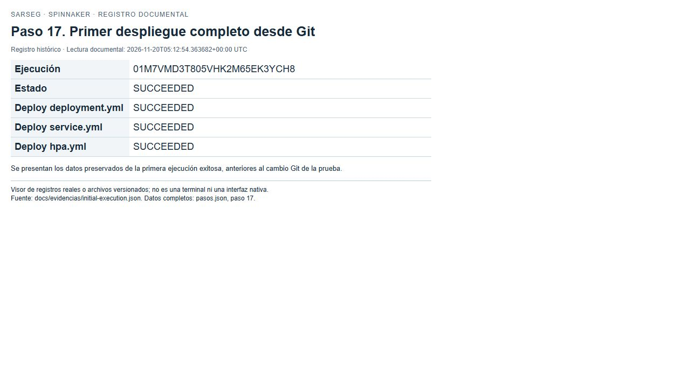


Nota. Elaboración propia: visor documental de registro histórico. Fuente completa: recorrido-apa7/pasos.json, paso 17.


### Paso 18. Comprobación HTTP por el NodePort


Se comprobó el acceso a la web y a /health/ready por el NodePort. Ambas solicitudes respondieron HTTP 200 y la API informó ready, lo que acredita conectividad con PostgreSQL en el laboratorio (JOURT1, 2026a) (Figura 18).


**Figura 18**

*Comprobación HTTP por el NodePort*


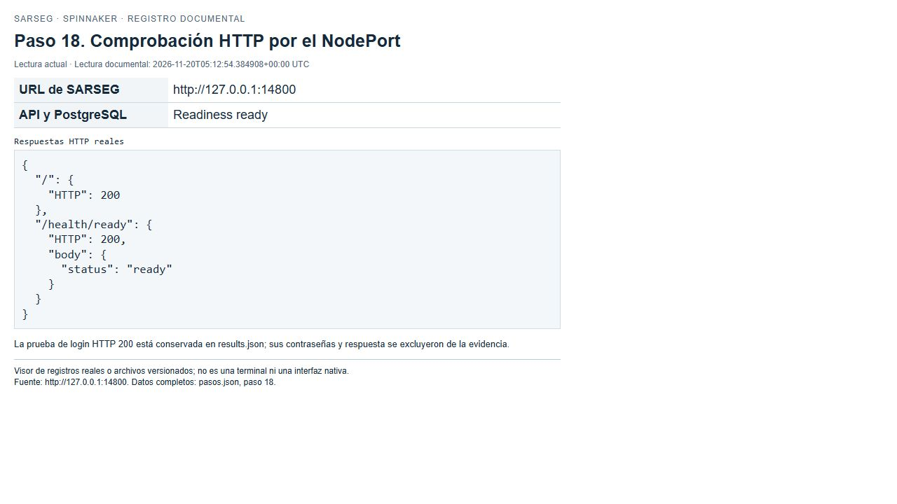


Nota. Elaboración propia: visor documental de lectura actual. Fuente completa: recorrido-apa7/pasos.json, paso 18.


### Paso 19. Aplicación SARSEG en el navegador


Se abrió la página real de SARSEG en el navegador mediante el puerto local 14800. La captura muestra la interfaz Ionic/Angular servida desde Kubernetes y complementa la verificación HTTP anterior (JOURT1, 2026b) (Figura 19).


**Figura 19**

*Aplicación SARSEG en el navegador*


Nota. Captura directa del navegador del 20 de noviembre de 2026. Fuente: http://127.0.0.1:14800.


### Paso 20. Publicación del cambio Git de la prueba


Se publicó un commit que modifica sarseg.edu/revision en la plantilla de Pods. La diferencia Git identifica el cambio utilizado para demostrar detección y despliegue automáticos sin aplicar manualmente los tres YAML (JOURT1, 2026a) (Figura 20).


**Figura 20**

*Publicación del cambio Git de la prueba*


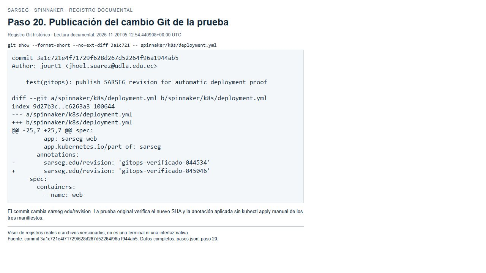


Nota. Elaboración propia: visor documental de registro git histórico. Fuente completa: recorrido-apa7/pasos.json, paso 20.


### Paso 21. Spinnaker despliega automáticamente la revisión


El sondeo inició Spinnaker para el SHA publicado. La captura nativa de Deck muestra parámetros y tres etapas correctas; la prueba también verificó la nueva anotación de revisión en Kubernetes (JOURT1, 2026a) (Figura 21).


**Figura 21**

*Spinnaker despliega automáticamente la revisión*


Nota. Captura nativa de Deck de la prueba original. Ejecución 01M7VMP5J4C39HZM0Y8G8C4GX1; registro preservado en git-execution.json.


### Paso 22. Generación de carga HTTP temporal


Se generaron solicitudes HTTP con un Job temporal de 48 trabajadores, limitado a una CPU. El objetivo fue producir consumo real en la web para que el HPA ajustara la capacidad, sin kubectl scale (JOURT1, 2026a) (Figura 22).


**Figura 22**

*Generación de carga HTTP temporal*


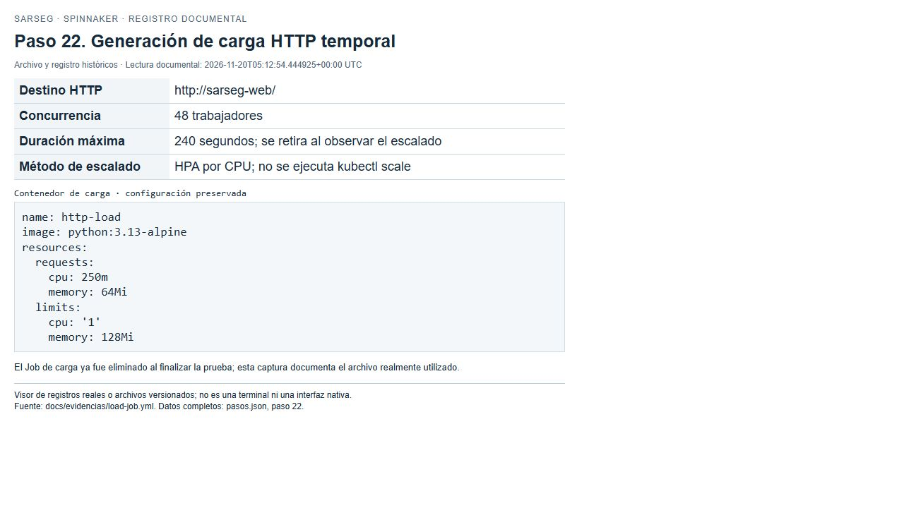


Nota. Elaboración propia: visor documental de archivo y registro históricos. Fuente completa: recorrido-apa7/pasos.json, paso 22.


### Paso 23. HPA: incremento automático a cinco réplicas


Bajo carga, el Deployment alcanzó cinco Pods Ready y el HPA registró cinco réplicas actuales y deseadas. La utilización superó el objetivo del 50%, activando el aumento automático (Kubernetes, s. f.-b; JOURT1, 2026a) (Figura 23).


**Figura 23**

*HPA: incremento automático a cinco réplicas*


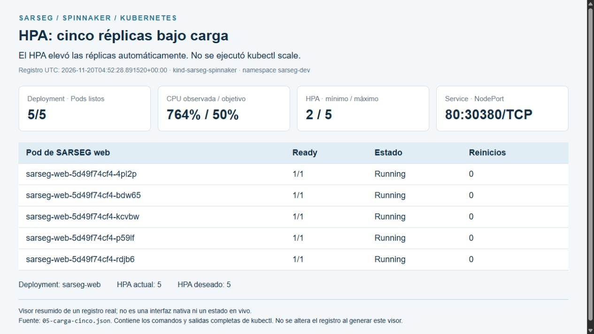


Nota. Visor de registros de la prueba original del 19 de noviembre. Sus comandos, estados y fechas UTC están preservados en JSON.


### Paso 24. HPA: retorno automático a dos réplicas


Al retirar la carga, el HPA redujo la capacidad a dos Pods Ready. La evidencia final confirma dos réplicas en el Deployment y en el contador del HPA después de la estabilización configurada (JOURT1, 2026a) (Figura 24).


**Figura 24**

*HPA: retorno automático a dos réplicas*


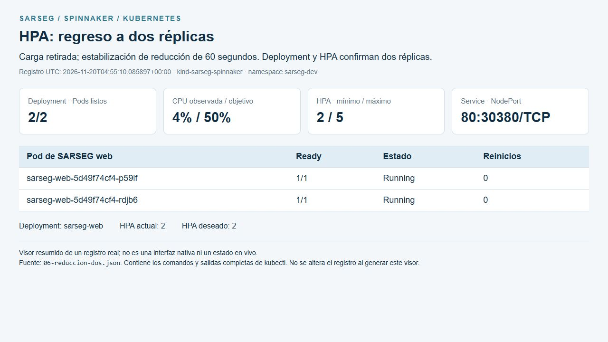


Nota. Visor de registros de la prueba original del 19 de noviembre. Sus comandos, estados y fechas UTC están preservados en JSON.


### Paso 25. Integración en main y validación final


Se integraron implementación y evidencias mediante los pull requests 8 y 9. La rama main quedó desplegada correctamente y la validación adicional de GitHub Actions finalizó con éxito (JOURT1, 2026b) (Figura 25).


**Figura 25**

*Integración en main y validación final*


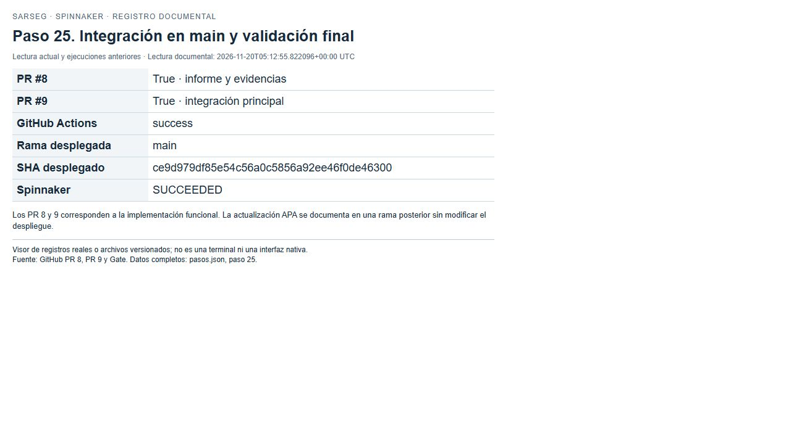


Nota. Elaboración propia: visor documental de lectura actual y ejecuciones anteriores. Fuente completa: recorrido-apa7/pasos.json, paso 25.


### Paso 26. Repositorio público y archivos de entrega


Se verificó el acceso público al repositorio y la presencia de deployment.yml, service.yml y hpa.yml en main. La entrega reúne estos archivos, el pipeline, los scripts reproducibles y el informe con evidencias (JOURT1, 2026b) (Figura 26).


**Figura 26**

*Repositorio público y archivos de entrega*


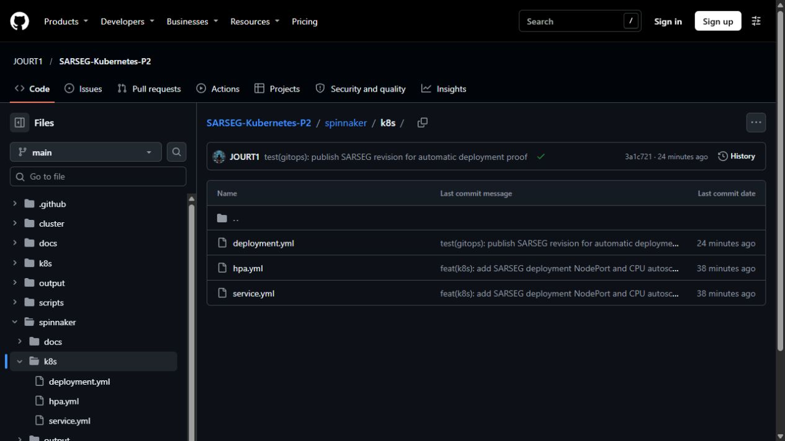


Nota. Captura directa del navegador del 20 de noviembre de 2026. Fuente: GitHub público.


## Resultados y discusión


Las once comprobaciones finalizaron correctamente. La Tabla 2 vincula cada condición con su resultado; las salidas completas se conservan en results.json y en los estados asociados del repositorio (JOURT1, 2026a).


**Tabla 2. Verificaciones de integración de SARSEG y Spinnaker**


| Comprobación | Resultado |

|---|---|

| Dos Pods iniciales Ready | Aprobado |

| Recursos y selectores coincidentes | Aprobado |

| Service NodePort accesible | Aprobado |

| HPA: mínimo 2, máximo 5 y CPU 50% | Aprobado |

| Web y API disponibles por HTTP | Aprobado |

| Login real HTTP 200 | Aprobado |

| Métricas CPU/memoria disponibles | Aprobado |

| Nuevo SHA desplegado automáticamente | Aprobado |

| Tres etapas de Spinnaker SUCCEEDED | Aprobado |

| Incremento automático de 2 a 5 | Aprobado |

| Reducción automática de 5 a 2 | Aprobado |

El cambio Git verificado fue 3a1c721e4f71729f628d267d52264f96a1944ab5. La ejecución 01M7VMP5J4C39HZM0Y8G8C4GX1 terminó en SUCCEEDED y aplicó la revisión esperada. La evidencia de carga muestra cinco Pods Ready; después de retirarla, Deployment y HPA volvieron a dos.

La muestra de aumento registró 764% de utilización respecto de los requests. Esto no significa exceder el límite de CPU: el porcentaje se calcula sobre la solicitud de 25m por Pod. El objetivo del 50% equivale a 12,5m por Pod, por lo que la carga justificó el escalamiento (Kubernetes, s. f.-b, s. f.-c).


## Incidencias, límites y conclusiones


La primera definición del pipeline no enlazó el artefacto esperado y terminó en TERMINAL. La corrección declaró el artefacto HTTP en la etapa y parametrizó su referencia con gitSha. Las ejecuciones posteriores verificaron los tres manifiestos. También se añadió una espera de PostgreSQL antes de iniciar la API para evitar fallos durante el arranque.

La infraestructura se ejecuta en una computadora, con puertos limitados a loopback y configuración de desarrollo. La web y la API se construyen desde el repositorio privado original, cuyo código y credenciales no se publican. La reproducción completa requiere permiso para obtener ese código o disponer de las imágenes locales compiladas.

Se cumplió el objetivo de desplegar SARSEG automáticamente desde Git con Spinnaker. El Deployment inició con dos réplicas, el Service permitió acceso por NodePort, Metrics Server suministró métricas y el HPA ajustó la capacidad de dos a cinco y nuevamente a dos. La detección Git quedó documentada como adaptación local con diferencias frente a Argo CD.


## Referencias


American Psychological Association. (s. f.-a). <i>Figure setup.</i> https://apastyle.apa.org/style-grammar-guidelines/tables-figures/figures


American Psychological Association. (s. f.-b). <i>Title page setup.</i> https://apastyle.apa.org/style-grammar-guidelines/paper-format/title-page


Docker. (s. f.). <i>Docker Desktop.</i> Docker Docs. https://docs.docker.com/desktop/


JOURT1. (2026a). <i>Resultados y evidencias originales del laboratorio SARSEG con Spinnaker</i> [Conjunto de datos]. GitHub. https://github.com/JOURT1/SARSEG-Kubernetes-P2/tree/main/spinnaker/docs/evidencias


JOURT1. (2026b). <i>SARSEG Kubernetes P2: Laboratorio local de configuración continua con Spinnaker</i> [Repositorio de código]. GitHub. https://github.com/JOURT1/SARSEG-Kubernetes-P2/tree/main/spinnaker


Kubernetes. (s. f.-a). <i>Deployments.</i> https://kubernetes.io/docs/concepts/workloads/controllers/deployment/


Kubernetes. (s. f.-b). <i>Horizontal Pod autoscaling.</i> https://kubernetes.io/docs/concepts/workloads/autoscaling/horizontal-pod-autoscale/


Kubernetes. (s. f.-c). <i>Resource management for Pods and containers.</i> https://kubernetes.io/docs/concepts/configuration/manage-resources-containers/


Kubernetes. (s. f.-d). <i>Service.</i> https://kubernetes.io/docs/concepts/services-networking/service/


Kubernetes SIGs. (s. f.-a). <i>Configuration.</i> kind. https://kind.sigs.k8s.io/docs/user/configuration/


Kubernetes SIGs. (s. f.-b). <i>Metrics Server</i> (Versión 0.8.1) [Software]. GitHub. https://github.com/kubernetes-sigs/metrics-server/tree/v0.8.1


Spinnaker. (s. f.-a). <i>HTTP file.</i> https://spinnaker.io/docs/reference/artifacts/types/http-file/


Spinnaker. (s. f.-b). <i>Kubernetes provider overview.</i> https://spinnaker.io/docs/reference/providers/kubernetes/


Spinnaker. (2026). <i>Spinnaker Kustomize</i> (Versión 2026.4.1) [Software]. GitHub. https://github.com/spinnaker/spinnaker/tree/1b3ed435fe5341b41dcbbdce999cb771145166a8/spinnaker-kustomize


Universidad de Las Américas. (s. f.). <i>Marca UDLA.</i> https://www.udla.edu.ec/la-udla/marca-udla/


## Apéndice A


Los siguientes listados reproducen los tres archivos utilizados. Se mantienen separados para facilitar la revisión de la consigna y su relación con las figuras 9 a 12. Fuente: repositorio del laboratorio (JOURT1, 2026b).


### deployment.yml


```yaml
apiVersion: apps/v1
kind: Deployment
metadata:
  name: sarseg-web
  namespace: sarseg-dev
  labels:
    app: sarseg-web
    app.kubernetes.io/part-of: sarseg
  annotations:
    strategy.spinnaker.io/use-source-capacity: 'true'
spec:
  replicas: 2
  revisionHistoryLimit: 3
  selector:
    matchLabels:
      app: sarseg-web
  strategy:
    type: RollingUpdate
    rollingUpdate:
      maxSurge: 1
      maxUnavailable: 0
  template:
    metadata:
      labels:
        app: sarseg-web
        app.kubernetes.io/part-of: sarseg
      annotations:
        sarseg.edu/revision: 'gitops-verificado-045046'
    spec:
      containers:
        - name: web
          image: sarseg-web:9984bc57
          imagePullPolicy: IfNotPresent
          env:
            - name: DOMAIN
              value: ':8080'
          ports:
            - name: http
              containerPort: 8080
          resources:
            requests:
              cpu: 25m
              memory: 32Mi
            limits:
              cpu: 250m
              memory: 128Mi
          readinessProbe:
            httpGet:
              path: /
              port: http
            periodSeconds: 5
          livenessProbe:
            httpGet:
              path: /
              port: http
            initialDelaySeconds: 10
            periodSeconds: 10
```


### service.yml


```yaml
apiVersion: v1
kind: Service
metadata:
  name: sarseg-web
  namespace: sarseg-dev
  labels:
    app: sarseg-web
spec:
  type: NodePort
  selector:
    app: sarseg-web
  ports:
    - name: http
      protocol: TCP
      port: 80
      targetPort: http
      nodePort: 30380
```


### hpa.yml


```yaml
apiVersion: autoscaling/v2
kind: HorizontalPodAutoscaler
metadata:
  name: sarseg-web
  namespace: sarseg-dev
spec:
  scaleTargetRef:
    apiVersion: apps/v1
    kind: Deployment
    name: sarseg-web
  minReplicas: 2
  maxReplicas: 5
  metrics:
    - type: Resource
      resource:
        name: cpu
        target:
          type: Utilization
          averageUtilization: 50
  behavior:
    scaleUp:
      stabilizationWindowSeconds: 0
      policies:
        - type: Pods
          value: 3
          periodSeconds: 15
    scaleDown:
      stabilizationWindowSeconds: 60
      policies:
        - type: Pods
          value: 3
          periodSeconds: 15
```


## Apéndice B


El punto de entrada es spinnaker/scripts/Start-Lab.ps1. Para reutilizar imágenes compiladas se usa -SkipBuild. La rama seguida por defecto es main. Para repetir una demostración con un commit nuevo, el sondeo debe seguir la misma rama donde se publicará el cambio.

docs/evidencias conserva las once comprobaciones, los estados del HPA y las ejecuciones de Gate. recorrido-apa7/pasos.json contiene las lecturas de los 26 pasos; capturas/ conserva las imágenes y encuadres.json identifica el recorte del visor en el PDF. Los archivos originales no se editan al maquetar las figuras.

SHA256SUMS.txt permite comprobar la integridad del recorrido. El trabajo se conserva en ramas y commits separados. El logotipo se mantiene en su PNG original y su procedencia se registra en docs/assets/FUENTE-LOGOTIPO.md.
